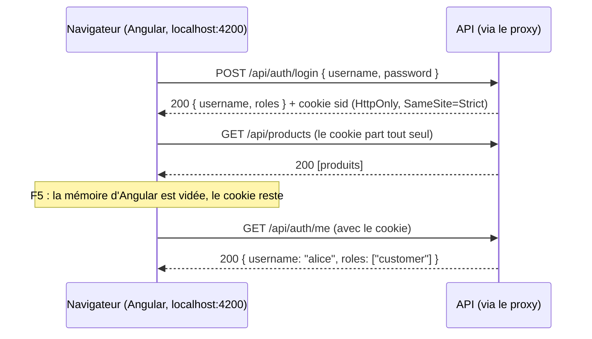

# 🔐 04 — La session

> **Scénario guidé, environ 60 minutes.** Vous remplissez la bibliothèque `@shop/auth` : un store
> de session alimenté par le serveur, une page de connexion, un bouton de session pour l'en-tête,
> un intercepteur qui réagit quand la session expire, et une fonction `provideAuth()` qui charge
> la session au démarrage. Les fichiers à écrire sont donnés en squelettes, avec des `// TODO`. La
> solution est dans `solution/libs/auth/`, à n'ouvrir qu'en cas de blocage.

## ✨ Objectifs

- Comprendre une **session par cookie httpOnly** : Angular ne stocke aucun jeton, il demande au
  serveur « qui est connecté ? ».
- Écrire un second store, `SessionStore`, dont l'état vient du serveur.
- Charger la session **avant la première navigation** avec `provideAppInitializer`, pour qu'un F5
  la conserve.
- Écrire une page de connexion en Signal Forms, qui revient à la page demandée (`returnUrl`).
- Composer l'en-tête avec un second composant projeté, sans que `ui` dépende de `auth`.
- Écrire un **intercepteur** qui transforme un 401 en retour vers la connexion.

## 📁 Point de départ

Vous partez du FO de l'étape 03 : catalogue, panier et commande fonctionnent, pour n'importe qui.
La bibliothèque `@shop/auth` est encore vide. À la fin de cette étape, elle contiendra ceci :

```
libs/auth/src/
├── public-api.ts                         la façade : une ligne par fichier créé (récapitulée en section 7)
└── lib/
    ├── auth.config.ts                    provideAuth() (section 3)
    ├── models/user.ts                    (section 2)
    ├── services/session.store.ts         SessionStore (section 2)
    ├── pages/login/                      la page de connexion (section 4)
    ├── components/session-button/        le bouton de l'en-tête (section 5)
    └── interceptors/auth.interceptor.ts  le 401 (section 6)
```

L'API doit tourner (terminal 1) : toute cette étape lui parle.

---

## 🍪 1 — Le principe : le serveur garde la session

Au jour 2 comme dans beaucoup de projets v20, on aurait rangé un jeton dans `localStorage` et
on l'aurait recopié dans chaque requête. Ici, le serveur de l'étape 02 fait autrement : à la
connexion, il pose un cookie `sid` **httpOnly**, que le navigateur renvoie tout seul à chaque
requête vers la même origine, et qu'aucun JavaScript ne peut lire. Le schéma suit les échanges,
de la connexion jusqu'au rechargement de la page :



Angular n'a donc que trois choses à faire, et c'est le plan de cette étape :

| Besoin | Réponse |
|---|---|
| savoir qui est connecté | un store, `SessionStore`, rempli par la réponse de `/api/auth/me` ou de `/api/auth/login` (section 2) |
| le savoir dès le démarrage, même après F5 | `provideAppInitializer` appelle `/api/auth/me` avant la première navigation (section 3) |
| réagir quand le serveur dit « session expirée » | un intercepteur qui transforme un `401` en retour vers la page de connexion (section 6) |

> 📖 [Synthèse authentification : où garder le jeton](https://bngams.github.io/2610-ng/03-intro-auth/)

---

## 🗃️ 2 — Le modèle et le store de session

### 2.1 — `User`

Ce que l'application doit savoir de l'utilisateur tient dans la réponse du serveur : un nom et des
rôles. Générez le fichier dans la famille `models/` de la bibliothèque :

```bash
npx ng generate interface models/user --project @shop/auth
```

La CLI crée une interface vide ; remplacez le contenu de `libs/auth/src/lib/models/user.ts` :

```ts
/** L'utilisateur connecté, tel que l'API le renvoie sur /api/auth/me et /api/auth/login. */
export interface User {
  username: string;
  roles: string[];
}
```

Un fichier de bibliothèque n'est visible des applications que s'il est exporté par la façade, et
celle de `auth` est vide depuis l'étape 01. Ajoutez-y une ligne à chaque fichier créé dans cette
étape, en commençant par celui-ci. Après cet ajout, `libs/auth/src/public-api.ts` contient :

```ts
/*
 * Public API Surface of auth
 */

export * from './lib/models/user';
```

### 2.2 — `SessionStore`

La session est un store, comme le panier : un état privé, une vue en lecture seule, une valeur
dérivée et des actions. La différence est que ses actions **appellent le serveur**. Générez-le :

```bash
npx ng generate service services/session --type store --project @shop/auth --skip-tests
```

Les actions renvoient des `Promise`, et non des `Observable`, pour une raison précise :
`provideAppInitializer` (section 3) sait **attendre** une promesse avant de démarrer le routeur.
La fonction `firstValueFrom` de RxJS fait le pont : elle transforme l'Observable de `HttpClient` en
promesse, et la promesse **rejette** si la requête échoue. Remplacez le contenu de
`libs/auth/src/lib/services/session.store.ts` par ce squelette, et complétez les cinq `TODO` :

🚧 **À compléter :**

```ts
import { Service, computed, inject, signal } from '@angular/core';
import { HttpClient } from '@angular/common/http';
import { firstValueFrom } from 'rxjs';
import { API_URL } from '@shop/api';
import { User } from '../models/user';

/** La session : QUI est connecté, d'après le serveur. Aucun jeton ici : il vit dans un cookie httpOnly. */
@Service()
export class SessionStore {
  private readonly http = inject(HttpClient);
  private readonly apiUrl = inject(API_URL);

  // l'état : privé ; null = personne n'est connecté
  private readonly _user = signal<User | null>(null);

  // la vue publique et les valeurs dérivées
  // TODO 1 : readonly user = … (la vue en lecture seule de _user)
  // TODO 2 : readonly isLoggedIn = computed(…) -> vrai si _user n'est pas null

  /** La RÈGLE de rôle, partagée par les guards et par le menu. */
  hasRole(role: string): boolean {
    // TODO 3 : vrai si l'utilisateur existe et que ses roles contiennent role (sinon false)
  }

  /** « Qui suis-je ? » : le navigateur joint le cookie tout seul. Appelé au démarrage (provideAuth). */
  async loadSession(): Promise<void> {
    try {
      // TODO 4 : GET `${this.apiUrl}/auth/me`, transformé en promesse par firstValueFrom,
      //          et la réponse rangée dans _user
    } catch {
      this._user.set(null); // 401 : personne n'est connecté, ce n'est pas une panne
    }
  }

  /** La réponse pose le cookie httpOnly ; son corps ne contient que l'utilisateur. Rejette si refusé. */
  async login(username: string, password: string): Promise<void> {
    const user = await firstValueFrom(
      this.http.post<User>(`${this.apiUrl}/auth/login`, { username, password }),
    );
    this._user.set(user);
  }

  /** Le serveur supprime la session et efface le cookie ; vider le signal seul ne suffirait pas. */
  async logout(): Promise<void> {
    try {
      // TODO 5 : POST `${this.apiUrl}/auth/logout` avec un corps vide {}, attendu avec firstValueFrom
    } finally {
      this._user.set(null);
    }
  }
}
```

Les indices, `TODO` par `TODO` :

| TODO | Indice |
|---|---|
| 1 | `this._user.asReadonly()`, comme `lines` dans le panier |
| 2 | `computed(() => this._user() !== null)` |
| 3 | `this._user()?.roles.includes(role) ?? false` : `?.` s'arrête si personne n'est connecté, `??` remplace alors `undefined` par `false` |
| 4 | `this._user.set(await firstValueFrom(this.http.get<User>(…)))`, sur le modèle de `login()` |
| 5 | `await firstValueFrom(this.http.post(…, {}))` |

Quatre choix de ce store méritent d'être nommés :

| Choix | Pourquoi |
|---|---|
| l'état vient **du serveur**, jamais de la lecture d'un jeton | un jeton décodé dans le navigateur peut être périmé ou révoqué ; la réponse de `/auth/me` reflète la session réelle |
| un `401` sur `/auth/me` donne `null`, sans erreur | « personne n'est connecté » est un état normal, pas une panne. C'est aussi pourquoi l'intercepteur de `@shop/api` ignore les 401 |
| `login()` laisse remonter l'erreur | c'est la page de connexion qui décide quoi afficher (« Identifiants invalides ») |
| `logout()` appelle le serveur, puis vide le signal **dans tous les cas** (`finally`) | le cookie est httpOnly : seul le serveur peut l'effacer. Et même si l'appel échoue, l'interface ne doit plus afficher l'utilisateur |

`hasRole()` est une méthode et non un `computed`, car elle prend un paramètre. Elle lit quand même
le signal `_user` : un template ou un `computed` qui l'appelle se met à jour tout seul à la
connexion et à la déconnexion.

Exportez le store dans la façade, sous la ligne du modèle :

```ts
export * from './lib/services/session.store';
```

> 📖 [`firstValueFrom`](https://rxjs.dev/api/index/function/firstValueFrom) ·
> [Synthèse store : la session](https://bngams.github.io/2610-ng/03-intro-store/)

---

## 🚦 3 — `provideAuth()` : la session dès le démarrage

Après un F5, le signal `_user` repart à `null`, mais le cookie est toujours là. Il faut donc
appeler `loadSession()` au démarrage, et surtout **avant** que le routeur n'affiche la première
page : à l'étape 05, un guard demandera « est-on connecté ? », et il doit déjà connaître la
réponse. C'est le rôle de `provideAppInitializer` : Angular exécute la fonction qu'on lui donne
pendant le démarrage, et attend la promesse qu'elle renvoie.

Sur le modèle de `provideApi()`, la bibliothèque offre une fonction de configuration. Créez à la
main le fichier `libs/auth/src/lib/auth.config.ts` :

```ts
import { EnvironmentProviders, inject, makeEnvironmentProviders, provideAppInitializer } from '@angular/core';
import { SessionStore } from './services/session.store';

/**
 * Prépare l'authentification de l'application : avant la première navigation, on demande au
 * serveur qui est connecté. Ainsi un F5 garde la session, et les guards la connaissent déjà.
 */
export function provideAuth(): EnvironmentProviders {
  return makeEnvironmentProviders([
    // Angular attend la promesse avant de démarrer le routeur
    provideAppInitializer(() => inject(SessionStore).loadSession()),
  ]);
}
```

La fonction passée à `provideAppInitializer` renvoie la promesse de `loadSession()` : c'est ce
`return` implicite de la fonction fléchée qui fait attendre Angular. Avec des accolades et sans
`return` (`() => { inject(SessionStore).loadSession(); }`), Angular ne recevrait rien à attendre.

> ℹ️ **Un nom vérifié dans Angular 22.** `provideAppInitializer(fn)` remplace l'ancien jeton
> `APP_INITIALIZER` (`{ provide: APP_INITIALIZER, useFactory: …, multi: true }`), que vous croiserez
> dans le code v20 ; la fonction accepte un retour `Promise`, `Observable` ou rien.

Comme pour le store, ajoutez la ligne de ce fichier à la fin de `libs/auth/src/public-api.ts` :

```ts
export * from './lib/auth.config';
```

> 📖 [`provideAppInitializer`](https://angular.dev/api/core/provideAppInitializer)

---

## 🔑 4 — La page de connexion

La page de connexion est la même pour le FO et le BO : elle vit dans `@shop/auth`, dans la famille
`pages/`. Générez-la :

```bash
npx ng generate component pages/login --project @shop/auth --skip-tests
```

Le formulaire est écrit en **Signal Forms**, comme le dossier de candidature du jour 2 : un signal
pour le modèle, `form()` pour les règles, `[formField]` pour lier un champ, `submit()` pour
l'envoi. Après une connexion réussie, la page revient à l'adresse demandée, lue dans le paramètre
`returnUrl` de l'URL ; par prudence, une adresse qui commence par `/login` renvoie à l'accueil, pour
ne pas boucler sur la page de connexion. Remplacez le contenu de
`libs/auth/src/lib/pages/login/login.ts` et complétez les trois `TODO` :

🚧 **À compléter :**

```ts
import { Component, inject, signal } from '@angular/core';
import { ActivatedRoute, Router } from '@angular/router';
import { FormField, form, required, submit } from '@angular/forms/signals';
import { MatButtonModule } from '@angular/material/button';
import { MatFormFieldModule } from '@angular/material/form-field';
import { MatInputModule } from '@angular/material/input';
import { SessionStore } from '../../services/session.store';

@Component({
  imports: [FormField, MatFormFieldModule, MatInputModule, MatButtonModule],
  selector: 'lib-login',
  styleUrl: './login.css',
  templateUrl: './login.html',
})
export class Login {
  protected readonly session = inject(SessionStore);
  private readonly router = inject(Router);
  private readonly route = inject(ActivatedRoute);

  // le modèle du formulaire, et le formulaire Signal Forms construit dessus
  private readonly credentials = signal({ username: '', password: '' });
  protected readonly loginForm = form(this.credentials, (path) => {
    // TODO 1 : les deux champs sont obligatoires
  });
  protected readonly error = signal('');

  async send(event: Event): Promise<void> {
    event.preventDefault();
    this.error.set('');
    await submit(this.loginForm, async () => {
      const { username, password } = this.credentials();
      try {
        // TODO 2 : se connecter avec le store de session (attendre la promesse)
      } catch {
        // TODO 3 : afficher « Identifiants invalides » (le signal error)
        return; // refusé : on reste sur la page
      }
      // retour à la page demandée avant la redirection (guard, intercepteur ou bouton)
      const returnUrl = this.route.snapshot.queryParamMap.get('returnUrl');
      await this.router.navigateByUrl(returnUrl?.startsWith('/login') ? '/' : (returnUrl ?? '/'));
    });
  }
}
```

Les indices :

| TODO | Indice |
|---|---|
| 1 | `required(path.username);` et la même chose pour `password` |
| 2 | `await this.session.login(username, password);` : si le serveur refuse, la promesse rejette et l'on passe dans le `catch` |
| la navigation, hors du `try` | seul l'échec de la connexion doit afficher « Identifiants invalides » ; une erreur de navigation n'a rien à voir avec le mot de passe |
| 3 | `this.error.set('Identifiants invalides');` |

Le template rappelle les comptes de démonstration, et prévient si l'on est déjà connecté (le BO
s'en servira à l'étape 06, quand un compte n'a pas le bon rôle). Les champs sont des `matInput`
dans des `mat-form-field`, et `[formField]` les relie au formulaire. Remplacez le contenu de
`login.html` :

```html
<h1>Connexion</h1>
<p class="demo">
  Comptes de démonstration, factices : alice / alice (cliente), admin / admin (administrateur).
</p>
@if (session.user(); as user) {
  <p>Vous êtes connecté en tant que {{ user.username }} : cette page demande un autre compte.</p>
}
<form novalidate (submit)="send($event)">
  <mat-form-field>
    <mat-label>Utilisateur</mat-label>
    <input matInput [formField]="loginForm.username" autocomplete="username" />
  </mat-form-field>
  <mat-form-field>
    <mat-label>Mot de passe</mat-label>
    <input
      matInput
      type="password"
      [formField]="loginForm.password"
      autocomplete="current-password"
    />
  </mat-form-field>
  <button mat-flat-button type="submit">Se connecter</button>
</form>
@if (error()) {
  <p class="error">{{ error() }}</p>
}
```

Le bouton n'est volontairement **pas** désactivé quand le formulaire est invalide : `submit()`
refuse déjà un formulaire invalide, et un bouton `[disabled]` mis à jour avec un temps de retard
empêcherait la touche Entrée d'envoyer le formulaire si l'on tape très vite. Les styles empilent
les champs ; remplacez le contenu de `login.css` :

```css
form {
  display: flex;
  flex-direction: column;
  max-width: 320px;
}
.demo {
  color: var(--mat-sys-on-surface-variant);
}
.error {
  color: var(--mat-sys-error);
}
```

> ℹ️ **Pourquoi Material est importé directement ?** La règle du workspace est
> `auth => api` : `auth` n'importe pas `@shop/ui`. Elle n'a besoin que de modules Material, qu'elle
> importe depuis `@angular/material/…`.

La page rejoint la façade, à la fin de `libs/auth/src/public-api.ts` :

```ts
export * from './lib/pages/login/login';
```

> 📖 [Signal Forms](https://angular.dev/guide/forms/signals/overview) ·
> [Angular Material : form field](https://material.angular.dev/components/form-field/overview)

---

## 👤 5 — Le bouton de session, dans l'en-tête

Le bouton de session a deux états : anonyme, il affiche « Se connecter » ; connecté, il affiche le
nom de l'utilisateur et « Se déconnecter ». Il est partagé par le FO et le BO, donc il vit dans
`@shop/auth`. Générez-le :

```bash
npx ng generate component components/session-button --project @shop/auth --skip-tests
```

Le composant lit le store et navigue. « Se connecter » envoie vers `/login` en gardant la page
courante dans `returnUrl` ; « Se déconnecter » attend le serveur, puis renvoie à l'accueil.
Remplacez le contenu de `libs/auth/src/lib/components/session-button/session-button.ts` et
complétez les deux `TODO` :

🚧 **À compléter :**

```ts
import { Component, inject } from '@angular/core';
import { Router } from '@angular/router';
import { MatButtonModule } from '@angular/material/button';
import { SessionStore } from '../../services/session.store';

/** Anonyme : « Se connecter ». Connecté : le nom, et « Se déconnecter ». */
@Component({
  imports: [MatButtonModule],
  selector: 'lib-session-button',
  styleUrl: './session-button.css',
  templateUrl: './session-button.html',
})
export class SessionButton {
  protected readonly session = inject(SessionStore);
  private readonly router = inject(Router);

  login(): void {
    // returnUrl : la page courante, pour y revenir après la connexion
    // TODO 1 : naviguer vers ['/login'] avec queryParams: { returnUrl: this.router.url }
  }

  async logout(): Promise<void> {
    // TODO 2 : attendre la déconnexion du store de session
    // 'reload' : même si l'on est déjà sur '/', le routeur refait la navigation, donc rejoue les guards
    await this.router.navigateByUrl('/', { onSameUrlNavigation: 'reload' });
  }
}
```

Pour le `TODO 1`, `this.router.navigate([...], { queryParams: { … } })` ; pour le `TODO 2`,
`await this.session.logout();`. L'option `onSameUrlNavigation: 'reload'` règle un cas précis : par
défaut, le routeur **ignore** une navigation vers l'adresse où l'on se trouve déjà. Sans elle, se
déconnecter en étant déjà sur `/` ne relancerait ni la navigation, ni ses guards. Dans le FO,
l'accueil n'est pas protégé et rien ne se verrait ; dans le BO (étape 06), l'accueil est réservé
aux administrateurs, et la page protégée resterait affichée après la déconnexion.

Le template choisit l'un des deux états avec `@if … ; as user`. Remplacez le contenu de
`session-button.html` :

```html
@if (session.user(); as user) {
  <span class="username">{{ user.username }}</span>
  <button mat-button type="button" (click)="logout()">Se déconnecter</button>
} @else {
  <button mat-button type="button" (click)="login()">Se connecter</button>
}
```

Le nom et le bouton s'alignent sur une ligne ; remplacez le contenu de `session-button.css` :

```css
:host {
  display: flex;
  align-items: center;
  gap: 8px;
}
```

Avant de l'utiliser dans le FO, exportez-le, à la fin de `libs/auth/src/public-api.ts` : sans cette
ligne, l'import `from '@shop/auth'` du FO échouerait à la compilation.

```ts
export * from './lib/components/session-button/session-button';
```

Le bouton rejoint le badge du panier dans l'**emplacement** de l'en-tête. C'est la même
composition qu'à l'étape 03 : l'application décide, `ui` ne sait rien de la session. Dans
`apps/fo/src/app/app.html`, ajoutez-le après le badge :

```html
<lib-header title="MiniShop" [menuItems]="menu">
  <app-cart-badge />
  <lib-session-button />
</lib-header>
```

Dans `apps/fo/src/app/app.ts`, ajoutez `import { SessionButton } from '@shop/auth';` et
`SessionButton` au tableau `imports` du décorateur.

> ℹ️ **Pourquoi un clic, et pas un `routerLink` avec `[queryParams]` ?** L'adresse courante,
> `router.url`, n'est pas un signal : dans un template, elle ne serait pas relue à chaque
> navigation, et `returnUrl` resterait figé sur la première page. Lue au moment du clic, elle est
> toujours juste.

---

## 🛡️ 6 — L'intercepteur du 401

Quand le serveur répond `401` à un appel métier, la session n'existe plus de son côté (expirée, ou
API redémarrée). Le FO doit alors oublier l'utilisateur et proposer de se reconnecter, en
revenant ensuite à la page en cours. C'est un comportement transversal, qui concerne toutes les
requêtes : un intercepteur. Générez-le dans la famille `interceptors/` ; l'option
`--type-separator=.` donne au fichier le nom `auth.interceptor.ts` (au lieu de
`auth-interceptor.ts`, le défaut de la CLI) :

```bash
npx ng generate interceptor interceptors/auth --type-separator=. --project @shop/auth --skip-tests
```

L'intercepteur laisse passer la requête, puis surveille la réponse. Les appels à `/auth/` sont
exclus : un mauvais mot de passe répond aussi `401`, et ne doit pas rediriger. Remplacez le contenu
de `libs/auth/src/lib/interceptors/auth.interceptor.ts` et complétez les deux `TODO` :

🚧 **À compléter :**

```ts
import { HttpErrorResponse, HttpInterceptorFn } from '@angular/common/http';
import { inject } from '@angular/core';
import { Router } from '@angular/router';
import { catchError, throwError } from 'rxjs';
import { SessionStore } from '../services/session.store';

/**
 * Un 401 sur un appel métier veut dire « session expirée » : on oublie l'utilisateur et on renvoie
 * vers la page de connexion, en gardant la page courante dans returnUrl.
 */
export const authInterceptor: HttpInterceptorFn = (req, next) => {
  const session = inject(SessionStore);
  const router = inject(Router);

  return next(req).pipe(
    catchError((err: unknown) => {
      // les appels /auth/ sont exclus : un mauvais mot de passe (401 aussi) ne doit pas rediriger
      if (err instanceof HttpErrorResponse && err.status === 401 && !req.url.includes('/auth/')) {
        // TODO 1 : se déconnecter côté store (efface aussi un cookie devenu invalide)
        // TODO 2 : naviguer vers ['/login'] avec returnUrl = router.url
      }
      return throwError(() => err);
    }),
  );
};
```

Le `TODO 1` est `session.logout().catch(() => {});` : pas d'`await`, car l'intercepteur n'a pas à
attendre la réponse pour rediriger ; et le `.catch` ignore un éventuel échec de cet appel, puisque le
`finally` de `logout()` vide la session locale dans tous les cas (sans lui, l'échec apparaîtrait
dans la console comme une promesse rejetée non traitée). Le `TODO 2` reprend la navigation du
bouton de session. L'erreur est ensuite
relancée (`throwError`) : l'appelant la reçoit toujours.

> ℹ️ **Pas de dépendance circulaire.** L'intercepteur injecte `SessionStore`, qui injecte
> `HttpClient`, qui exécute l'intercepteur. Cela fonctionne, car un intercepteur fonctionnel n'est
> exécuté (et ses `inject()` résolus) qu'au moment d'une requête, quand tout est déjà construit.

L'intercepteur est la dernière pièce à exporter, à la fin de `libs/auth/src/public-api.ts` :

```ts
export * from './lib/interceptors/auth.interceptor';
```

### 6.1 — Brancher l'intercepteur, et `provideAuth()`

Les intercepteurs fonctionnels d'Angular se déclarent dans **un seul** appel,
`provideHttpClient(withInterceptors([...]))`, et c'est `provideApi()` qui le fait. `@shop/auth`
exporte donc son intercepteur, et l'application le passe à `provideApi()` dans l'option
`interceptors` prévue à l'étape 02 ; `provideAuth()`, lui, s'occupe du chargement de la session.
Remplacez le contenu de `apps/fo/src/app/app.config.ts` :

```ts
import { ApplicationConfig, provideBrowserGlobalErrorListeners } from '@angular/core';
import { provideRouter, withComponentInputBinding } from '@angular/router';
import { provideApi } from '@shop/api';
import { authInterceptor, provideAuth } from '@shop/auth';
import { routes } from './app.routes';

export const appConfig: ApplicationConfig = {
  providers: [
    provideBrowserGlobalErrorListeners(),
    // withComponentInputBinding : le paramètre :id de la route arrive dans un input() du composant
    provideRouter(routes, withComponentInputBinding()),
    // HttpClient + l'adresse de l'API + la chaîne d'intercepteurs : celui de @shop/auth, puis celui de l'api
    provideApi({ url: '/api', interceptors: [authInterceptor] }),
    // la session est chargée avant la première navigation
    provideAuth(),
  ],
};
```

> ⚖️ **Pourquoi pas un second `provideHttpClient()` dans `provideAuth()` ?** Ce serait tentant :
> chaque bibliothèque branche son intercepteur elle-même. Mais `provideHttpClient()` installe à
> chaque appel toute la mécanique HTTP (et son intercepteur XSRF interne) ; l'appeler deux fois
> n'est pas une configuration prévue. Une seule liste d'intercepteurs, écrite dans l'application,
> garde aussi l'**ordre** visible : celui d'`auth`, puis celui d'`api`.

> 📖 [Intercepteurs](https://angular.dev/guide/http/interceptors) ·
> [`ng generate interceptor`](https://angular.dev/cli/generate/interceptor)

---

## 📤 7 — La façade de `auth`, et la route de connexion

Faites le point sur la façade : ligne après ligne, `libs/auth/src/public-api.ts` contient
maintenant les six exports de cette étape. Vérifiez qu'il correspond à ceci :

```ts
/*
 * Public API Surface of auth
 */

export * from './lib/models/user';
export * from './lib/services/session.store';
export * from './lib/auth.config';
export * from './lib/pages/login/login';
export * from './lib/components/session-button/session-button';
export * from './lib/interceptors/auth.interceptor';
```

La page de connexion vient d'une bibliothèque, mais c'est l'application qui choisit son adresse.
Dans `apps/fo/src/app/app.routes.ts`, importez `Login` depuis `@shop/auth` et ajoutez la route,
juste avant `**` :

```ts
  { path: 'login', component: Login },
```

---

## 🚀 8 — Vérifier

Commencez par le build du FO :

```bash
npx ng build fo
```

Il réussit, avec un avertissement nouveau :

```
▲ [WARNING] bundle initial exceeded maximum budget. Budget 500.00 kB was not met by 31.62 kB with a total of 531.62 kB.
```

C'est un **avertissement**, pas une erreur : Material et Signal Forms ont fait passer le code chargé
au démarrage au-dessus du seuil fixé dans `angular.json` (`budgets`, 500 kB). On le laisse tel quel
dans ce lab ; dans un vrai projet, on chercherait d'abord ce qui peut être chargé à la demande.

### 8.1 — Le cookie, vu par `curl`

La réponse de connexion se lit avec `curl -i`, à travers le proxy du FO (le port 4200) :

```bash
curl -si -X POST http://localhost:4200/api/auth/login -H 'Content-Type: application/json' -d '{"username":"alice","password":"alice"}'
```

Les lignes utiles de la réponse sont le statut, le cookie et le corps :

```
HTTP/1.1 200 OK
set-cookie: sid=1bdaa9e64da30e0aaf7dd2c226618cd37cac70318077dbf3; Max-Age=1800; Path=/; Expires=Tue, 13 Oct 2026 22:48:30 GMT; HttpOnly; SameSite=Strict
content-type: application/json; charset=utf-8

{
  "username": "alice",
  "roles": [
    "customer"
  ]
}
```

Le corps ne contient **aucun jeton** : seulement qui est connecté. Le jeton (l'identifiant de
session) est dans le cookie, marqué `HttpOnly` et `SameSite=Strict`.

### 8.2 — Dans le navigateur

Rechargez http://localhost:4200, console ouverte, et suivez ce parcours. Tant que personne n'est
connecté, chaque chargement de page affiche en rouge, dans la console,
`Failed to load resource: the server responded with a status of 401 (Unauthorized)` : c'est le
navigateur lui-même qui journalise la réponse `401` de `GET /api/auth/me`, et c'est attendu ;
l'intercepteur de `@shop/api`, lui, ignore les `401` et n'écrit rien.

> 💡 **Tester :**
> 1. L'en-tête affiche « Panier » et « Se connecter ». Depuis `/catalog`, « Se connecter » mène à
>    `/login?returnUrl=%2Fcatalog`.
> 2. `alice` avec un mauvais mot de passe : « Identifiants invalides », on reste sur la page (le
>    `POST /api/auth/login` répond `401`, sans redirection).
> 3. `alice` / `alice` : retour sur `/catalog`, et l'en-tête affiche « alice » et « Se déconnecter ».
> 4. Dans la console, `document.cookie` renvoie `""` et
>    `(await cookieStore.getAll()).map(c => c.name)` renvoie `[]` : le cookie `sid` est invisible
>    pour JavaScript. L'onglet **Application > Cookies** des DevTools, lui, le montre, avec la case
>    `HttpOnly` cochée. `Object.keys(localStorage)` ne contient que `minishop.cart` : aucun jeton.
> 5. F5 : l'en-tête affiche toujours « alice ». L'onglet Réseau montre `GET /api/auth/me` en `200`,
>    lancé par `provideAuth()` au démarrage.
> 6. « Se déconnecter » : retour à l'accueil, et « Se connecter » réapparaît. Après un F5, l'onglet
>    Réseau montre `GET /api/auth/me` => `401` : il n'y a plus de session.

> 🧪 **Manip — la session expire**
>
> Toutes les requêtes du FO sont des lectures publiques : aucune ne peut répondre `401`. Pour voir
> l'intercepteur au travail, on simule une session perdue, puis on lance à la main un appel
> protégé.
>
> 1. Connectez-vous en `alice`, puis allez sur `/cart`.
> 2. Dans le terminal 1, arrêtez l'API (`Ctrl-C`) et relancez-la (`npm run api`) : les sessions,
>    gardées en mémoire, sont perdues. **Ne rechargez pas** la page : l'en-tête affiche toujours
>    « alice ».
> 3. Dans la console, lancez une écriture à travers le `HttpClient` de l'application.
>    `ng.getComponent` est un outil de débogage d'Angular, disponible en mode développement : il
>    donne l'instance d'un composant affiché, ici le bouton de session, dont on emprunte le store
>    et son `HttpClient`. Ces champs sont `protected` et `private` en TypeScript, mais cette
>    visibilité n'existe plus à l'exécution : lire un champ privé depuis la console est une astuce
>    de débogage, jamais une façon de coder :
>    `ng.getComponent(document.querySelector('lib-session-button')).session.http.delete('/api/products/1').subscribe({ error: () => {} })`
> 4. Observez l'URL, l'en-tête et l'onglet Réseau.
>
> *Observé : `DELETE /api/products/1` répond `401`, l'intercepteur appelle `POST /api/auth/logout`
> (`204`), puis la page passe à `/login?returnUrl=%2Fcart`, et l'en-tête affiche de nouveau « Se
> connecter ». Après la connexion, vous revenez sur `/cart`.*

---

## 🎉 Challenge final

- [ ] Aucun jeton n'est stocké par Angular : ni dans `localStorage`, ni dans un signal.
- [ ] Un F5 garde la session, grâce à `provideAuth()` et `/api/auth/me`.
- [ ] La connexion revient à la page demandée (`returnUrl`).
- [ ] `@shop/ui` n'importe toujours rien de `@shop/auth` : le bouton de session est projeté par
      l'application.

## ✅ Bonus

- Faites afficher au bouton de session les rôles de l'utilisateur entre parenthèses, à côté de
  son nom (`user.roles.join(', ')`).
- Lisez la section « XSRF : le double submit » de la
  [synthèse authentification](https://bngams.github.io/2610-ng/03-intro-auth/) : que faudrait-il
  ajouter au serveur, et à Angular, pour une seconde barrière contre le CSRF ?

## 🧠 Récap

- Session par cookie httpOnly : le **serveur** garde la session, Angular demande « qui est
  connecté ? » (`/api/auth/me`) et ne stocke aucun jeton.
- `SessionStore` suit le pattern du panier, avec des actions qui appellent HTTP et renvoient des
  promesses.
- `provideAppInitializer` attend `loadSession()` avant la première navigation : F5 garde la
  session, et les guards la connaîtront.
- L'intercepteur transforme un `401` métier en retour vers `/login?returnUrl=…` ; il est déclaré
  dans la seule liste d'intercepteurs, celle de `provideApi()`.

---

➡️ [05 — Les guards côté FO](05-GUARDS.md)
