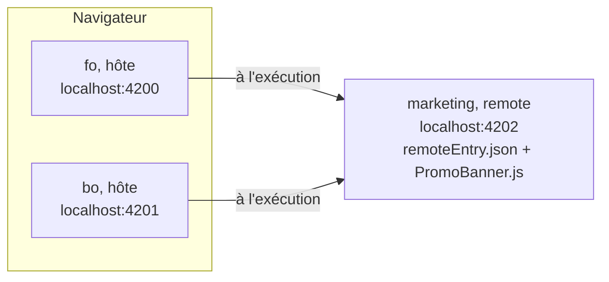

# 🧩 08 — Une bannière promo en micro-frontend

> **Scénario guidé, environ 50 minutes.** L'équipe marketing veut changer la promo de la semaine
> sans attendre la prochaine livraison de la boutique. Vous créez pour elle une troisième
> application, `marketing`, qui expose un seul composant, la bannière `PromoBanner`, puis le FO et
> le BO la chargent **à l'exécution** avec Native Federation : un remote, deux hôtes. Les commandes
> sont données ; un seul fichier contient des `// TODO`. Le résultat attendu est dans
> `solution/apps/marketing/`, `solution/apps/fo/`, `solution/apps/bo/` et `solution/libs/ui/`, à
> n'ouvrir qu'en cas de blocage.

## ✨ Objectifs

- Comprendre ce qu'un **micro-frontend** apporte par rapport à une bibliothèque : un morceau
  d'interface construit et déployé à part, assemblé dans le navigateur.
- Transformer une application en **remote** et deux applications en **hôtes dynamiques** avec
  `ng add @angular-architects/native-federation`.
- Charger un composant distant **dans** une page, avec un repli si le remote est arrêté.
- Constater qu'on met à jour la bannière en relançant **seulement** `marketing`.
- (Bonus) Vérifier qu'une bibliothèque partagée en **singleton** donne au remote la session de
  l'hôte.

## 📁 Point de départ

Vous partez du workspace de l'étape 07 : le FO et le BO fonctionnent, et leurs deux pages
d'accueil commencent par le commentaire `<!-- emplacement réservé : une bannière viendra ici
(étape 08) -->`. Voici ce que cette étape ajoute ou modifie ; les fichiers générés par la CLI ou
par Native Federation sans retouche ne sont pas tous listés :

```
apps/marketing/                              la nouvelle application, le remote (sections 2 et 3)
├── federation.config.mjs                    ce que le remote expose : ./PromoBanner
├── src/app/app.ts, app.html                 la page de l'application lancée seule
├── src/app/app.config.ts                    la session, pour le bonus
└── src/app/components/promo-banner/         la bannière
apps/fo/, apps/bo/                           les deux hôtes (sections 4 et 5)
├── federation.config.mjs                    ce que l'hôte partage
├── public/federation.manifest.json          où trouver le remote : http://localhost:4202
├── src/main.ts, src/bootstrap.ts            le démarrage, coupé en deux
└── src/app/pages/home/                      la bannière dans l'accueil (section 7)
libs/ui/src/
├── lib/models/remote-loader.ts              le contrat « charger un module distant » (section 5)
├── lib/components/remote-slot/              l'emplacement qui affiche le composant distant (section 6)
└── public-api.ts                            + deux exports (sections 5 et 6)
package.json                                 + le script marketing, + Native Federation
angular.json                                 + le projet marketing ; le proxy de marketing pour le bonus
```

Vous aurez besoin d'un **cinquième terminal** pour lancer `marketing`, en plus de l'API
(terminal 1), du FO (terminal 2), du BO (terminal 3) et du terminal des commandes (terminal 4).

---

## 🤔 1 — Pourquoi un micro-frontend ?

Jusqu'ici, tout ce qui est partagé passe par une **bibliothèque** : l'en-tête de `@shop/ui` est
compilé **dans** le FO et **dans** le BO. Si la bannière promo était un composant de `@shop/ui`,
changer le texte de la promo demanderait de recompiler et de redéployer les deux applications.
Un **micro-frontend** est un morceau d'interface construit et déployé **indépendamment**, souvent
par une autre équipe, et assemblé dans le navigateur au moment où la page s'affiche. Le tableau
compare les deux façons de partager la bannière :

| | Bannière dans `@shop/ui` (bibliothèque) | Bannière dans `marketing` (remote) |
|---|---|---|
| Quand elle rejoint le FO et le BO | à la compilation de chaque application | à l'exécution, dans le navigateur |
| Changer la promo | recompiler et redéployer le FO **et** le BO | recompiler et redéployer `marketing` seule ; le FO et le BO affichent la nouvelle promo au prochain chargement |
| Si elle est en panne | impossible : elle fait partie du bundle | l'hôte doit prévoir un **repli** |
| Coût | aucun | une configuration de fédération, un serveur de plus, des erreurs qui n'apparaissent qu'à l'exécution |

Le schéma suivant montre l'architecture visée : un remote, `marketing`, chargé par deux hôtes.
Les flèches sont des requêtes du navigateur, au chargement de la page d'accueil :



On garde `marketing` **dans le même workspace**, volontairement : une seule version d'Angular
pour les trois applications, donc aucun conflit de version quand elles partagent Angular en
singleton (une seule copie chargée). Dans la vraie vie, un remote vit souvent dans un autre dépôt,
pour l'autonomie de son équipe ; le prix à payer est la dérive des versions, que l'option
`strictVersion` de Native Federation transforme en erreur au chargement, comme l'explique la
[synthèse workspace](https://bngams.github.io/2610-ng/03-intro-workspace/#s5).

> 🏷️ **Pourquoi `marketing` et `PromoBanner`, et pas `ads` et `AdsBanner` ?** Les bloqueurs de
> publicité (uBlock Origin, AdBlock Plus) appliquent la liste
> [EasyList](https://easylist.to/easylist/easylist.txt), qui contient 2 744 règles génériques de
> masquage visant « ads ». L'une d'elles, `##.ads-banner`, cache **tout** élément qui porte la
> classe `ads-banner`, sur n'importe quel site. Un participant équipé d'un bloqueur verrait donc
> une bannière invisible, sans aucune erreur dans la console. Les adresses du remote, elles,
> n'étaient pas bloquées lors de nos essais. La leçon vaut en production : un widget peut
> disparaître chez un client à cause d'un bloqueur ; évitez `ad` et `ads` dans les noms de
> classes et d'`id`.

> 📖 [Micro Frontends (martinfowler.com)](https://martinfowler.com/articles/micro-frontends.html) ·
> [Native Federation : le modèle mental](https://native-federation.com/docs/v4/mental-model/)

---

## 🏗️ 2 — L'application `marketing`

Le remote est d'abord une application Angular ordinaire, qui démarre seule sur son port. Dans le
terminal 4, générez-la comme le FO et le BO à l'étape 01. Elle n'a pas de pages, donc pas de
routes (`--routing=false`), et l'option `--skip-tests` évite la création des tests :

```bash
npx ng generate application marketing --project-root apps/marketing --routing=false --style=css --ssr=false --skip-tests
```

La CLI crée l'application dans `apps/marketing/` et l'inscrit dans `angular.json` et
`tsconfig.json` :

```
CREATE apps/marketing/src/app/app.ts (232 bytes)
CREATE apps/marketing/src/app/app.html (20126 bytes)
CREATE apps/marketing/src/main.ts (222 bytes)
CREATE apps/marketing/src/app/app.config.ts (203 bytes)
...
UPDATE angular.json (9178 bytes)
UPDATE tsconfig.json (1824 bytes)
```

La bannière est une carte Material : `marketing` a besoin du thème, comme les deux autres
applications. Lancez `ng add` pour ce troisième projet ; le paquet est déjà installé, la commande
configure seulement le thème. Elle vous pose la même question qu'à l'étape 01 : gardez la
première palette, `Azure/Blue`.

```bash
npx ng add @angular/material --project marketing
```

Trois retouches mettent l'application au niveau des deux autres :

1. dans `apps/marketing/src/index.html`, remplacez `<html lang="en">` par `<html lang="fr">` et
   `<title>Marketing</title>` par `<title>MiniShop Marketing</title>` ;
2. remplacez le contenu de `apps/marketing/src/styles.css` (un simple commentaire) par celui de
   `apps/fo/src/styles.css`, la règle `main` de l'étape 01 ;
3. dans `package.json`, ajoutez le script `"marketing": "ng serve marketing"` sous la ligne
   `"bo"`.

### 2.1 — La bannière

La bannière vit dans la famille `components/` de l'application. Générez-la ; `--skip-tests` est
inutile ici, car l'application a été générée avec cette option et la CLI l'a retenue pour tous
ses composants (dans `angular.json`, la clé `schematics` du projet) :

```bash
npx ng generate component components/promo-banner --project marketing
```

Le composant n'a pas de logique : un titre et un texte, dans une carte Material. Remplacez le
contenu de `apps/marketing/src/app/components/promo-banner/promo-banner.ts` :

```ts
import { Component } from '@angular/core';
import { MatCardModule } from '@angular/material/card';

/** La promo du moment, exposée par Native Federation : le FO et le BO la chargent à l'exécution. */
@Component({
  imports: [MatCardModule],
  selector: 'app-promo-banner',
  styleUrl: './promo-banner.css',
  templateUrl: './promo-banner.html',
})
export class PromoBanner {}
```

> ⚠️ **Piège : le barrel `@shop/ui` dans un remote.** Partout ailleurs, Material s'importe depuis
> `@shop/ui`. Ici, on l'importe directement depuis `@angular/material/card`, et ce n'est pas un
> oubli.
> - *Symptôme :* avec `import { MatCardModule } from '@shop/ui'`, la bannière s'affiche, mais la
>   console de l'hôte affiche `NG0912: Component ID generation collision detected. Components
>   '_Header' and '_Header' with selector 'lib-header' …`.
> - *Cause :* `@shop/ui` ne sera pas partagée entre les applications, car son barrel `export *`
>   ne survit pas à la compilation à part qu'exige le partage (la section 4 le montre). Le remote
>   embarque donc sa propre copie de la bibliothèque, en-tête compris, et l'hôte se retrouve avec
>   deux classes `Header`.
> - *Correctif :* un remote n'importe que ce qu'il affiche. Material, lui, est partagé : la carte
>   vient du même fichier que celle de l'hôte.

Le template met le titre dans l'en-tête de la carte, et le texte de la promo dans son contenu.
Remplacez le contenu de `promo-banner.html` :

```html
<mat-card class="promo" appearance="outlined">
  <mat-card-header>
    <mat-card-title>Offre de la semaine</mat-card-title>
  </mat-card-header>
  <mat-card-content>
    <p>-20 % sur les parfums, avec le code PARFUM20.</p>
  </mat-card-content>
</mat-card>
```

La classe s'appelle `promo`, et non `ads-banner`, pour la raison de l'encadré de la section 1. Les
styles colorent la carte avec une couleur du thème ; remplacez le contenu de `promo-banner.css` :

```css
.promo {
  margin-bottom: 16px;
  background: var(--mat-sys-primary-container);
}
```

### 2.2 — Le composant racine

Lancée seule, l'application affiche sa bannière : c'est ainsi que l'équipe marketing la
développe, sans le FO ni le BO. Remplacez le contenu de `apps/marketing/src/app/app.ts` :

```ts
import { Component } from '@angular/core';
import { PromoBanner } from './components/promo-banner/promo-banner';

@Component({
  imports: [PromoBanner],
  selector: 'app-root',
  styleUrl: './app.css',
  templateUrl: './app.html',
})
export class App {}
```

Le template généré, `app.html`, contient une page de démonstration de plusieurs centaines de
lignes : videz-le, et remplacez-le par ces lignes.

```html
<main>
  <h1>Marketing</h1>
  <p>L'application de l'équipe marketing, lancée seule : voici la bannière qu'elle expose.</p>
  <app-promo-banner />
</main>
```

---

## 🛰️ 3 — Faire de `marketing` un remote

Native Federation est publié par Angular Architects, et sa version suit celle d'Angular
(22.2.x pour Angular 22.2) : `npx ng version` affiche la vôtre, et le lab a été validé avec
Angular 22.2.2 et Native Federation 22.2.2. On l'installe d'abord en dépendance de
développement, comme l'indique son
[README](https://www.npmjs.com/package/@angular-architects/native-federation) ; son schematic,
lancé ensuite par `ng add`, transforme une application existante. Arrêtez le FO et le BO s'ils tournent (`Ctrl-C` dans les terminaux 2 et 3) : leur
configuration va changer. Dans le terminal 4 :

```bash
npm i -D @angular-architects/native-federation@22.2.2
```

Le schematic se lance ensuite sur `marketing`. Ses options disent quel projet transformer, sur
quel port il tournera, et quel rôle il joue :

```bash
npx ng add @angular-architects/native-federation@22.2.2 --project marketing --port 4202 --type remote --skip-confirmation
```

Chaque option a un rôle précis :

| Option | Rôle |
|---|---|
| `--project marketing` | le projet à transformer |
| `--port 4202` | le port du serveur de développement, écrit dans `angular.json` |
| `--type remote` | un **remote** : il expose des modules. Les autres valeurs sont `host` (liste de remotes figée au build) et `dynamic-host` (liste lue à l'exécution, section 4) |
| `--skip-confirmation` | une option de `ng add` : ne pas demander « installer ce paquet ? » |

Le paquet étant déjà installé, `ng add` passe directement au schematic, qui annonce le changement
de builder et liste les fichiers touchés :

```
Skipping installation: Package already installed
Switching project to the application builder using esbuild ...
CREATE apps/marketing/tsconfig.federation.json (78 bytes)
CREATE apps/marketing/federation.config.mjs (976 bytes)
CREATE apps/marketing/src/bootstrap.ts (219 bytes)
UPDATE angular.json (8510 bytes)
UPDATE apps/marketing/src/main.ts (255 bytes)
UPDATE package.json (1135 bytes)
✔ Packages installed successfully.
```

Voici ce que chaque fichier est devenu :

| Fichier | Ce qui change |
|---|---|
| `package.json` | `@angular-architects/native-federation` et `@softarc/native-federation-orchestrator` en `devDependencies`, `es-module-shims` en `dependencies` (le polyfill qui apporte les *import maps* aux navigateurs qui les gèrent mal) |
| `angular.json` | la cible `build` passe au builder de fédération, qui produit `remoteEntry.json` puis appelle le build Angular d'origine, renommé `esbuild` ; l'ancien `serve` devient `serve-original`, avec `"port": 4202` |
| `federation.config.mjs` | ce que le remote **expose** et ce qu'il **partage** |
| `tsconfig.federation.json` | la configuration TypeScript utilisée pour compiler les fichiers exposés et partagés ; elle étend `tsconfig.app.json`, on n'y touche pas |
| `src/main.ts` et `src/bootstrap.ts` | le démarrage est coupé en deux : `main.ts` initialise la fédération, puis importe `bootstrap.ts`, qui contient l'ancien `bootstrapApplication` |

Le démarrage en deux temps a une raison : avant qu'Angular ne démarre, la fédération doit savoir
**où** charger chaque dépendance partagée (Angular, Material…). Le `import('./bootstrap')`
dynamique laisse le temps à `initFederation` de le décider.

### 3.1 — Ce que le remote expose

Ouvrez `apps/marketing/federation.config.mjs`. Le schematic expose par défaut le composant racine
(`./Component`) ; c'est la bannière qu'on veut exposer, sous un nom explicite. Remplacez le bloc
`exposes` par celui-ci :

```js
  exposes: {
    './PromoBanner': './apps/marketing/src/app/components/promo-banner/promo-banner.ts',
  },
```

La clé `./PromoBanner` est le nom public, celui que les hôtes demanderont ; la valeur est le
fichier source, compilé à part pour l'occasion. Le reste du fichier, `shared: fromPackageJson({ singleton: true,
strictVersion: true, … })`, partage toutes les dépendances de `package.json` en singleton. On y
revient en section 4.

### 3.2 — Lancer le remote

Ouvrez un **terminal 5**, placez-le dans `shop/`, et lancez `marketing` :

```bash
npm run marketing
```

Le serveur construit d'abord les « artefacts de fédération », puis l'application :

```
 INFO  Building federation artifacts
 INFO  Bundling exposed modules
...
  ➜  Local:   http://localhost:4202/
```

> 💡 **Tester :** http://localhost:4202 affiche « Marketing » et la carte « Offre de la semaine ».
> Dans le terminal 4, `curl -s http://localhost:4202/remoteEntry.json | head -4` affiche le début
> du fichier que les hôtes liront (sous Windows, ouvrez plutôt cette adresse dans le
> navigateur) :
>
> ```
> {
>   "$version": "v4",
>   "name": "marketing",
>   "shared": [
> ```
>
> Plus bas, la clé `exposes` contient `"key": "./PromoBanner"` et le nom du fichier compilé,
> `PromoBanner.js`.

> 📖 [Native Federation : démarrer](https://native-federation.com/docs/v4/angular-adapter/getting-started/) ·
> [les options du schematic](https://native-federation.com/docs/v4/angular-adapter/schematics/)

---

## 🏠 4 — Faire du FO et du BO des hôtes dynamiques

Un hôte charge les modules exposés par des remotes. Un hôte **dynamique** lit la liste de ses
remotes à l'exécution, dans un fichier JSON, le **manifeste** : on peut changer l'adresse d'un
remote (par environnement, par exemple) sans recompiler l'hôte. Lancez le schematic sur le FO,
puis sur le BO, chacun avec son port :

```bash
npx ng add @angular-architects/native-federation@22.2.2 --project fo --port 4200 --type dynamic-host --skip-confirmation
npx ng add @angular-architects/native-federation@22.2.2 --project bo --port 4201 --type dynamic-host --skip-confirmation
```

La sortie du FO liste un fichier de plus que celle du remote, le manifeste :

```
CREATE apps/fo/public/federation.manifest.json (107 bytes)
CREATE apps/fo/tsconfig.federation.json (78 bytes)
CREATE apps/fo/federation.config.mjs (895 bytes)
CREATE apps/fo/src/bootstrap.ts (219 bytes)
UPDATE angular.json (9360 bytes)
UPDATE apps/fo/src/main.ts (279 bytes)
```

Le schematic a gardé ce que vous aviez écrit à l'étape 02 : dans `angular.json`, la cible
`serve-original` du FO contient toujours `"port": 4200` et `"proxyConfig": "proxy.conf.json"`.

### 4.1 — Le manifeste

Le manifeste est dans `public/` : il est copié tel quel dans `dist/`, donc modifiable après le
build. Ouvrez `apps/fo/public/federation.manifest.json` : le schematic y a inscrit **toutes** les
autres applications du workspace, le BO compris.

```json
{
  "bo": "http://localhost:4201/remoteEntry.json",
  "marketing": "http://localhost:4202/remoteEntry.json"
}
```

Le BO n'est pas un remote du FO : sans retouche, le FO irait chercher un `remoteEntry.json` sur le
port 4201 à chaque chargement. Supprimez la ligne `bo`, pour ne garder que `marketing` :

```json
{
  "marketing": "http://localhost:4202/remoteEntry.json"
}
```

Faites de même dans `apps/bo/public/federation.manifest.json`, qui contient une ligne `fo` à
supprimer : le résultat est identique.

### 4.2 — Ce que les trois applications partagent

`fromPackageJson` partage les paquets npm (Angular, Material, RxJS) en singleton : une seule copie
dans le navigateur, celle de l'hôte. Native Federation partage **aussi**, par défaut, les
bibliothèques du workspace, celles des alias `@shop/*` du `tsconfig.json`. Pour `@shop/ui`, ce
partage casse le FO au démarrage :

> ⚠️ **Piège : le barrel de `@shop/ui`, partagé.**
> - *Symptôme :* avec la configuration générée, http://localhost:4200 reste blanc, et la console
>   affiche `SyntaxError: The requested module 'blob:http://localhost:4200/…' does not provide an
>   export named 'MatBadgeModule'`.
> - *Cause :* une bibliothèque partagée est compilée à part, dans son propre fichier
>   (`_shop_ui.js`). Les lignes `export * from '@angular/material/badge'` du barrel de l'étape 01
>   n'y survivent pas : le fichier n'exporte que `Header`, et l'import
>   `{ MatBadgeModule } from '@shop/ui'` du badge du panier échoue.
> - *Correctif :* ne partager que ce qui doit l'être, avec l'option `sharedMappings`.

Une bibliothèque doit être partagée quand elle porte un **état** commun : un seul `SessionStore`,
un seul jeton `API_URL`. `@shop/ui` (des composants d'affichage) et `@shop/products` (des
composants, et un service sans état) peuvent être compilées dans chaque application sans dommage.
On partage donc `@shop/api` et `@shop/auth`, et seulement elles. Dans
`apps/fo/federation.config.mjs`, ajoutez la clé `sharedMappings` juste avant `skip` :

```js
  // les bibliothèques du workspace partagées : celles qui portent un état (le jeton API_URL, la session)
  sharedMappings: ['@shop/api', '@shop/auth'],

  skip: [
```

Ajoutez exactement les mêmes lignes dans `apps/bo/federation.config.mjs` et dans
`apps/marketing/federation.config.mjs` : les trois applications doivent être d'accord sur ce
qui est partagé. La configuration de fédération n'est lue qu'au démarrage : relancez `marketing`
(`Ctrl-C` puis `npm run marketing`, dans le terminal 5).

> ℹ️ **Pourquoi pas `@shop/products` ?** Elle importe `@shop/ui`. Partagée, elle embarquerait sa
> propre copie de `ui`, et l'en-tête existerait en deux exemplaires (le même avertissement
> `NG0912` que dans le piège de la section 2.1).

> 📖 [Native Federation : la configuration](https://native-federation.com/docs/v4/angular-adapter/configuration/)

---

## 🔌 5 — Transmettre la fédération à l'application

Le `main.ts` généré pour le FO initialise la fédération avec le manifeste, puis démarre
l'application **sans** lui transmettre le résultat :

```ts
initFederation('federation.manifest.json', {
  hostRemoteEntry: { url: './remoteEntry.json' },
})
  .catch((err) => console.error(err))
  .then((_) => import('./bootstrap'))
  .catch((err) => console.error(err));
```

Or c'est ce résultat qui sait charger un remote : sa fonction `loadRemoteModule(remote, clé)`.
La fonction du même nom qu'on importait autrefois directement du paquet existe encore, mais en
22.2.2 ses types la marquent `@deprecated` (« Prefer the loadRemoteModule returned by the
initFederation promise »). Il faut donc faire passer ce résultat jusqu'aux composants, en trois
temps.

### 5.1 — Le contrat, dans `@shop/ui`

Un composant ne doit pas importer Native Federation pour charger un remote : on lui donne une
fonction par l'injection de dépendances, sous un **jeton** (`InjectionToken`). Le jeton et le type
de la fonction vivent dans `@shop/ui`, car c'est un composant de `ui` qui les utilisera (section
6). `ui` déclare **ce dont elle a besoin** ; l'application fournira **comment** au démarrage. Le
fichier contient un type de fonction et un jeton, pas une interface : `ng generate interface`
n'aiderait pas. Créez-le à la main, `libs/ui/src/lib/models/remote-loader.ts` :

```ts
import { InjectionToken } from '@angular/core';

/**
 * Le contrat : « charge le module `exposed` du remote `remote` ». ui ne sait pas COMMENT
 * (Native Federation, ou autre chose) : c'est l'application qui fournit la fonction au démarrage.
 */
export type RemoteLoader = (remote: string, exposed: string) => Promise<Record<string, unknown>>;

export const REMOTE_LOADER = new InjectionToken<RemoteLoader>('REMOTE_LOADER');
```

La règle de dépendance de l'étape 01 est respectée : `ui` n'importe qu'Angular. Exportez le
fichier à la fin de `libs/ui/src/public-api.ts` :

```ts
export * from './lib/models/remote-loader';
```

### 5.2 — `main.ts` transmet le résultat

Dans `main.ts`, le résultat de `initFederation` (appelé `nf`) est passé à la fonction
`bootstrap`. Remplacez le contenu de `apps/fo/src/main.ts` :

```ts
import { initFederation } from '@angular-architects/native-federation';

// 1. lire le manifeste (où sont les remotes), 2. démarrer l'application en lui passant le résultat
initFederation('federation.manifest.json', {
  hostRemoteEntry: { url: './remoteEntry.json' },
})
  .then((nf) => import('./bootstrap').then((m) => m.bootstrap(nf)))
  .catch((err) => console.error(err));
```

Un remote arrêté ne fait **pas** échouer `initFederation` : la console note
`net::ERR_CONNECTION_REFUSED`, et l'application démarre quand même. C'est le chargement de la
bannière, plus tard, qui échouera, et la section 6 prévoit ce cas.

### 5.3 — `bootstrap.ts` fournit la fonction

`bootstrap.ts` exporte désormais une fonction qui reçoit `nf`, et ajoute un provider à la
configuration de l'application : sous le jeton `REMOTE_LOADER`, la fonction `nf.loadRemoteModule`.
`mergeApplicationConfig` réunit deux configurations en une, sans toucher à `app.config.ts`.
Remplacez le contenu de `apps/fo/src/bootstrap.ts` :

```ts
import { mergeApplicationConfig } from '@angular/core';
import { bootstrapApplication } from '@angular/platform-browser';
import { NativeFederationResult } from '@angular-architects/native-federation';
import { REMOTE_LOADER } from '@shop/ui';
import { appConfig } from './app/app.config';
import { App } from './app/app';

// nf : le résultat de initFederation (main.ts). Sa fonction loadRemoteModule devient injectable.
export const bootstrap = (nf: NativeFederationResult) =>
  bootstrapApplication(
    App,
    mergeApplicationConfig(appConfig, {
      providers: [{ provide: REMOTE_LOADER, useValue: nf.loadRemoteModule }],
    }),
  ).catch((err) => console.error(err));
```

Le BO démarre exactement de la même façon : copiez ces deux contenus dans `apps/bo/src/main.ts` et
`apps/bo/src/bootstrap.ts`.

> 📖 [`InjectionToken`](https://angular.dev/api/core/InjectionToken) ·
> [`mergeApplicationConfig`](https://angular.dev/api/core/mergeApplicationConfig) ·
> [Native Federation : le runtime](https://native-federation.com/docs/v4/angular-adapter/runtime/)

---

## 🧩 6 — `RemoteSlot` : un emplacement pour un composant distant

Le FO et le BO afficheront tous deux la bannière : le composant qui la charge est écrit une fois,
dans `@shop/ui`. Il reçoit trois textes (le remote, la clé exposée, le nom de la classe), charge
le module, et affiche le composant trouvé. Si le chargement échoue, il affiche à la place ce que
l'application a placé entre ses balises, ou rien. Générez-le :

```bash
npx ng generate component components/remote-slot --project @shop/ui --skip-tests
```

Deux outils d'Angular font tout le travail, résumés dans ce tableau :

| Outil | Rôle ici |
|---|---|
| `resource({ params, loader })` | le cousin de `httpResource` (jour 2) pour une promesse quelconque : `loader` renvoie une promesse, et le résultat se lit en signals, `value()`, `error()`, `isLoading()`, `hasValue()`. `params` relance le chargement si les inputs changent |
| `NgComponentOutlet` | affiche un composant dont on a la **classe** dans une variable : `<ng-container *ngComponentOutlet="classe" />`, l'équivalent dynamique de `<app-promo-banner />` |

Remplacez le contenu de `libs/ui/src/lib/components/remote-slot/remote-slot.ts`, et complétez les
trois `TODO` :

🚧 **À compléter :**

```ts
import { Component, Type, inject, input, resource } from '@angular/core';
import { NgComponentOutlet } from '@angular/common';
import { REMOTE_LOADER } from '../../models/remote-loader';

/**
 * Un emplacement pour un composant venu d'un remote, chargé à l'exécution.
 * S'il ne vient pas (remote arrêté), on affiche le contenu projeté, ou rien.
 */
@Component({
  imports: [NgComponentOutlet],
  selector: 'lib-remote-slot',
  styleUrl: './remote-slot.css',
  templateUrl: './remote-slot.html',
})
export class RemoteSlot {
  // TODO 1 : la fonction de chargement, injectée sous le jeton REMOTE_LOADER (champ privé loadRemote)

  /** Le nom du remote, celui du manifeste : 'marketing'. */
  readonly remote = input.required<string>();
  /** La clé exposée par le remote : './PromoBanner'. */
  readonly exposed = input.required<string>();
  /** Le nom de la classe exportée par ce module : 'PromoBanner'. */
  readonly component = input.required<string>();

  /** Le chargement, vu comme un signal : value() (la classe du composant), error(), isLoading(). */
  protected readonly loaded = resource({
    params: () => ({ remote: this.remote(), exposed: this.exposed(), component: this.component() }),
    loader: async ({ params }) => {
      // TODO 2 : attendre this.loadRemote(params.remote, params.exposed) : c'est le module du remote
      const type = module[params.component];
      if (typeof type !== 'function') {
        throw new Error(`${params.remote} n'exporte pas ${params.component}`);
      }
      // TODO 3 : renvoyer la classe trouvée, typée comme un composant (as Type<unknown>)
    },
  });
}
```

Voici les indices :

| TODO | Indice |
|---|---|
| 1 | `private readonly loadRemote = inject(REMOTE_LOADER);`, comme n'importe quel service |
| 2 | `const module = await this.loadRemote(…);` : le module est un objet dont chaque clé est un export du fichier exposé, ici `{ PromoBanner: class … }` |
| 3 | `return type as Type<unknown>;` : `Type<unknown>` est le type d'une classe de composant, celui qu'attend `NgComponentOutlet` |

Une erreur levée dans `loader`, que ce soit le remote injoignable ou le `throw` d'un nom de classe
inconnu, ne fait pas planter la page : elle passe dans `loaded.error()`. Le template choisit donc
entre trois états. Remplacez le contenu de `remote-slot.html` :

```html
@if (loaded.hasValue()) {
  <!-- le composant du remote, créé ici comme s'il était écrit dans le template -->
  <ng-container *ngComponentOutlet="loaded.value()" />
} @else if (loaded.error()) {
  <!-- le repli : ce que l'application a placé entre les balises, ou rien -->
  <ng-content />
}
```

Pendant le chargement, aucune branche ne s'affiche : l'emplacement reste vide. L'ordre des tests
compte : `value()` **lève une erreur** quand la ressource est en erreur, d'où `hasValue()` en
premier, qui renvoie simplement `false`. Le composant est un bloc ; remplacez le contenu de
`remote-slot.css` :

```css
:host {
  display: block;
}
```

Exportez le composant à la fin de `libs/ui/src/public-api.ts` :

```ts
export * from './lib/components/remote-slot/remote-slot';
```

> ℹ️ **Le composant distant voit l'injecteur de l'hôte.** `NgComponentOutlet` crée la bannière
> **ici**, dans l'arbre de composants du FO : si elle injecte un service, c'est l'injecteur du FO
> qui répond. Le bonus s'en sert.

> 📖 [`resource`](https://angular.dev/guide/signals/resource) ·
> [`NgComponentOutlet`](https://angular.dev/api/common/NgComponentOutlet) ·
> [Afficher un composant par programme](https://angular.dev/guide/components/programmatic-rendering)

---

## 🏠 7 — La bannière dans les deux accueils

Il ne reste qu'à poser l'emplacement à la place du commentaire réservé depuis l'étape 01. Dans le
FO, un client n'a pas à savoir qu'une bannière manque : en cas de panne, l'emplacement reste vide.
Remplacez la première ligne de `apps/fo/src/app/pages/home/home.html`, le commentaire, par ces
deux lignes :

```html
<!-- la bannière promo, chargée à l'exécution depuis l'application marketing (étape 08) -->
<lib-remote-slot remote="marketing" exposed="./PromoBanner" component="PromoBanner" />
```

Dans `apps/fo/src/app/pages/home/home.ts`, importez `RemoteSlot` depuis `@shop/ui` et ajoutez-le
au tableau `imports` du décorateur, vide jusqu'ici : `imports: [RemoteSlot]`.

Le BO suit le même schéma, avec une différence : un administrateur, lui, doit savoir que l'aperçu
de la promo est indisponible. Le message se place **entre** les balises : c'est le contenu
projeté par `<ng-content />` en cas d'erreur. Dans `apps/bo/src/app/pages/home/home.html`,
remplacez le commentaire de la première ligne par ce bloc :

```html
<!-- la bannière promo, chargée à l'exécution depuis l'application marketing (étape 08) -->
<lib-remote-slot remote="marketing" exposed="./PromoBanner" component="PromoBanner">
  <p class="promo-off">Aperçu de la promo indisponible : l'application marketing ne répond pas.</p>
</lib-remote-slot>
```

Pour finir le BO :

1. dans `home.ts`, importez `RemoteSlot` depuis `@shop/ui` et ajoutez-le au tableau `imports`, à
   côté de `ProductList` ;
2. dans `home.css`, vide jusqu'ici, ajoutez une règle `.promo-off` qui grise et met en italique le
   message (`color: var(--mat-sys-on-surface-variant); font-style: italic;`).

---

## 🚀 8 — Vérifier

### 8.1 — Les builds, et les tests de l'étape 07

Commencez par compiler les trois applications, dans le terminal 4 :

```bash
npx ng build marketing
npx ng build fo
npx ng build bo
```

Chaque build commence désormais par les artefacts de fédération. Celui du FO se termine ainsi :

```
 INFO  Building federation artifacts
 INFO  Bundling shared mappings with bundle type 'mapping-bundle'
...
Initial chunk files   | Names          |  Raw size | Estimated transfer size
main-INZ3SDQZ.js      | main           |  79.95 kB |                22.23 kB
...
Lazy chunk files      | Names          |  Raw size | Estimated transfer size
chunk-RU4UBADD.js     | catalog-routes |   7.60 kB |                 1.90 kB
chunk-JYMEH466.js     | cart-routes    |   6.18 kB |                 1.49 kB
chunk-6RLSOQA5.js     | -              |   4.82 kB |                 1.63 kB
chunk-DFBQYH7I.js     | bootstrap      |   3.93 kB |                 1.22 kB
```

L'avertissement de budget de l'étape 04 (531 kB) a disparu : Angular, Material et les deux
bibliothèques partagées ne sont plus dans le bundle initial, mais dans des fichiers à part
(`dist/fo/browser/_angular_core….js`, `_shop_auth.js`…), chargés par l'*import map*. Le nouveau
lazy chunk `bootstrap` est le fichier importé par `main.ts`.

Les tests de l'étape 07 ne passent pas par `main.ts` : ils restent verts.

```bash
npx ng test fo --watch=false
npx ng test @shop/products --watch=false
```

Le premier affiche `Tests  4 passed (4)`, le second `Tests  7 passed (7)`.

### 8.2 — Un remote, deux hôtes

Lancez les quatre serveurs, chacun dans son terminal, depuis `shop/` : `npm run api`
(terminal 1), `npm run fo` (terminal 2), `npm run bo` (terminal 3) et `npm run marketing`
(terminal 5, s'il ne tourne plus). `ng serve fo` et `ng serve bo` passent désormais par le
builder de fédération, puis démarrent l'application par `main.ts`, puis `bootstrap.ts`.

> 💡 **Tester :**
> 1. http://localhost:4200 affiche la carte « Offre de la semaine » au-dessus de « Bienvenue sur
>    MiniShop ».
> 2. Connectez-vous en `admin` / `admin` sur http://localhost:4201 : la même carte s'affiche
>    au-dessus de « Back-office » et de la liste des produits.
> 3. Sur le FO, ouvrez l'onglet **Réseau**, rechargez la page, et filtrez sur `4202` : deux
>    requêtes seulement viennent de `marketing`, `remoteEntry.json` et `PromoBanner.js`. Filtrez
>    ensuite sur `angular_core` : `_angular_core….js` vient de `localhost:4200`, l'hôte.
> 4. Dans la console du FO, lisez l'*import map* construite par la fédération :
>    `JSON.parse(document.querySelector('script[type^="importmap"]').textContent).imports['marketing/./PromoBanner']`
>    renvoie `'http://localhost:4202/PromoBanner.js'`.

L'*import map* explique le point 3 : `PromoBanner.js` importe `@angular/core` et
`@angular/material/card` **par leur nom**, et l'*import map* de l'hôte fait pointer ces noms vers
les fichiers de l'hôte. La bannière ne pèse que son propre code.

### 8.3 — Changer la promo sans toucher au FO ni au BO

C'est la démonstration qui justifie l'étape : la promo change, et seule l'application `marketing`
est reconstruite.

> **🧪 Manip — une nouvelle promo**
>
> 1. Dans `promo-banner.html`, remplacez le texte du paragraphe par
>    `-30 % sur l'épicerie, avec le code EPICERIE30.`
> 2. Dans le terminal 5, arrêtez `marketing` (`Ctrl-C`) et relancez-la (`npm run marketing`). Son
>    serveur recompile déjà tout seul à l'enregistrement ; on le relance quand même pour simuler
>    ce qui se passe en production : un nouveau déploiement de `marketing`, et d'elle seule.
> 3. Rechargez http://localhost:4200, puis http://localhost:4201.
> 4. Regardez les terminaux 2 et 3.
>
> *Observé : les deux accueils affichent « -30 % sur l'épicerie », et les terminaux 2 et 3
> n'ont rien recompilé : aucune ligne nouvelle depuis le dernier démarrage.*

Remettez ensuite le texte d'origine, et relancez `marketing`. Avec une bibliothèque, la même
modification aurait demandé deux builds et deux déploiements ; ici, l'équipe marketing livre seule.

### 8.4 — Quand `marketing` est arrêtée

Un remote est un serveur de plus, donc une panne de plus possible. L'hôte doit continuer à
fonctionner sans lui.

> **🧪 Manip — le remote en panne**
>
> 1. Arrêtez `marketing` (`Ctrl-C` dans le terminal 5).
> 2. Rechargez http://localhost:4200, puis http://localhost:4201.
>
> *Observé : l'accueil du FO s'affiche sans bannière, le reste de la page est intact ; celui du
> BO affiche « Aperçu de la promo indisponible : l'application marketing ne répond pas. », puis
> la liste des produits. La console note `net::ERR_CONNECTION_REFUSED` (le manifeste pointe vers
> un serveur arrêté) et `[NF][6]: Failed to load module marketing/./PromoBanner: … NFError: Remote
> 'marketing' is not initialized.` (le chargement de la bannière, passé dans `loaded.error()`).*

Les terminaux 2 et 3 recopient aussi cette dernière erreur, préfixée par `[vite] (client)
[console.error]` : le serveur de développement relaie dans le terminal les erreurs de la console
du navigateur. Relancez `marketing` et rechargez : la bannière revient, et les hôtes n'ont
toujours rien recompilé. C'est
la panne « à l'exécution » propre aux micro-frontends : aucune compilation ne l'aurait détectée,
d'où le repli prévu dans `RemoteSlot`.

---

## ✅ Bonus — Une promo personnalisée

L'équipe marketing voudrait saluer le client connecté : « alice, -10 % de plus pour vous ». La
session est dans `SessionStore`, de `@shop/auth`. Le remote peut-il la lire ? Oui, à une
condition : que `@shop/auth` soit partagée en **singleton**, ce qu'elle est depuis la section 4.

### Le remote lit la session de l'hôte

Dans `promo-banner.ts`, injectez la session. Ajoutez `inject` à l'import de `@angular/core`,
l'import `import { SessionStore } from '@shop/auth';`, et ce champ dans la classe :

```ts
  // partagée en singleton : c'est la session de l'application hôte
  protected readonly session = inject(SessionStore);
```

Dans `promo-banner.html`, sous le paragraphe de la promo, ajoutez la ligne personnalisée, affichée
seulement si quelqu'un est connecté :

```html
    @if (session.user(); as user) {
      <p class="personal">{{ user.username }}, -10 % de plus pour vous.</p>
    }
```

La ligne se distingue par sa graisse ; ajoutez cette règle à `promo-banner.css` :

```css
.personal {
  font-weight: 500;
}
```

Lancée **seule**, `marketing` n'a ni `HttpClient`, ni `API_URL`, ni session : `SessionStore` ne
pourrait pas être construit. Elle a besoin des mêmes briques que le FO, sauf l'intercepteur de
`@shop/auth` (`provideApi` branche toujours, lui, l'intercepteur de retour d'erreur de l'api).
Remplacez le contenu de `apps/marketing/src/app/app.config.ts` :

```ts
import { ApplicationConfig, provideBrowserGlobalErrorListeners } from '@angular/core';
import { provideApi } from '@shop/api';
import { provideAuth } from '@shop/auth';

export const appConfig: ApplicationConfig = {
  providers: [
    provideBrowserGlobalErrorListeners(),
    // lancée seule, marketing a besoin de sa propre session (la bannière lit SessionStore) ;
    // chargée dans le FO ou le BO, la bannière utilise celle de l'hôte
    provideApi({ url: '/api' }),
    provideAuth(),
  ],
};
```

Pour que `/api` atteigne l'API, `marketing` a besoin du proxy, comme le FO et le BO. Dans
`angular.json`, la cible de son serveur est maintenant `serve-original` (et non plus `serve`) :
ajoutez `"proxyConfig": "proxy.conf.json"` dans ses `options`, après `"port": 4202`. Relancez
ensuite `marketing` (terminal 5), car `angular.json` a changé.

> 💡 **Tester :**
> 1. Sur le FO, connectez-vous en `alice` : l'accueil affiche « alice, -10 % de plus pour vous. »
>    dans la bannière. Déconnectez-vous : la ligne disparaît aussitôt, sans rechargement.
> 2. Connecté en `alice`, comparez dans la console du FO la session du remote et celle de
>    l'hôte :
>    `ng.getComponent(document.querySelector('app-promo-banner')).session === ng.getComponent(document.querySelector('lib-session-button')).session`
>    renvoie `true` : **une seule** instance.
> 3. http://localhost:4202, lancée seule, affiche aussi la ligne d'`alice` : le cookie de session
>    est lié à `localhost`, quel que soit le port (étape 06).

La ligne disparaît sans rechargement parce que le remote lit **le même signal** que l'en-tête de
l'hôte. Pour s'en convaincre, la manip suivante, facultative, retire `@shop/auth` du partage.

> **🧪 Manip — et sans singleton ?**
>
> 1. Dans `apps/marketing/federation.config.mjs` **seulement**, remplacez la ligne
>    `sharedMappings` par `sharedMappings: ['@shop/api'],`.
> 2. Relancez `marketing`, puis rechargez le FO, toujours connecté en `alice`.
> 3. Relancez la comparaison du point 2 dans la console.
>
> *Observé : l'en-tête affiche « alice », mais la bannière n'affiche plus la ligne
> personnalisée, et la comparaison renvoie `false`. Le `remoteEntry.json` de `marketing` ne
> mentionne plus `@shop/auth` : le remote embarque sa propre classe `SessionStore`. L'injecteur
> range chaque service sous sa classe : deux classes, donc deux instances, et celle du remote n'a
> jamais appelé `/api/auth/me`.*
>
> Remettez `sharedMappings: ['@shop/api', '@shop/auth'],` et relancez `marketing`.

C'est la « session en double » de la
[synthèse workspace](https://bngams.github.io/2610-ng/03-intro-workspace/#s6) : tout ce qui doit
être unique (la session, Angular lui-même) se partage explicitement.

---

## 🌉 Ouverture — Un remote affiché hors d'Angular

Le schematic de Native Federation a une option de plus, `--webcomponent` : le remote démarre alors
comme un **élément HTML personnalisé** (un *web component*), utilisable dans une page qui n'est
pas écrite en Angular. La même bannière pourrait ainsi s'afficher sur l'écran d'une borne en
magasin ou d'un affichage dynamique, avec un simple `<script>` et une balise. On ne le met pas en
œuvre ici.

> 📖 [Native Federation : les options du schematic](https://native-federation.com/docs/v4/angular-adapter/schematics/)

---

## 🎉 Challenge final

- [ ] `npx ng build marketing`, `npx ng build fo` et `npx ng build bo` réussissent, et les tests
      de l'étape 07 restent verts.
- [ ] Le FO et le BO affichent la bannière de `marketing` ; seuls `remoteEntry.json` et
      `PromoBanner.js` viennent du port 4202.
- [ ] Une nouvelle promo s'affiche dans les deux hôtes en relançant **seulement** `marketing`.
- [ ] `marketing` arrêtée, les deux accueils s'affichent, avec leur repli.
- [ ] (Bonus) La bannière salue l'utilisateur connecté dans l'hôte.

## 🧠 Récap

- Un **micro-frontend** est construit et déployé à part, et assemblé dans le navigateur ; une
  **bibliothèque** est compilée dans chaque application. On choisit le premier pour l'autonomie
  d'une équipe, en acceptant des pannes à l'exécution.
- `ng add @angular-architects/native-federation --project <app> --port <n> --type
  remote|dynamic-host` génère `federation.config.mjs`, coupe le démarrage en `main.ts` +
  `bootstrap.ts` et, pour un hôte dynamique, crée `public/federation.manifest.json`.
- En 22.2, on utilise le `loadRemoteModule` renvoyé par `initFederation` ; ici, il est fourni
  sous un jeton, `REMOTE_LOADER`, que `RemoteSlot` injecte. `resource` + `NgComponentOutlet`
  affichent le composant, ou un repli.
- On partage en singleton ce qui porte un **état** (`@shop/auth`, `@shop/api`) : le remote voit
  alors la session de l'hôte.

---

➡️ [09 — Bonus : de vraies notifications](09-NOTIFICATIONS.md)
