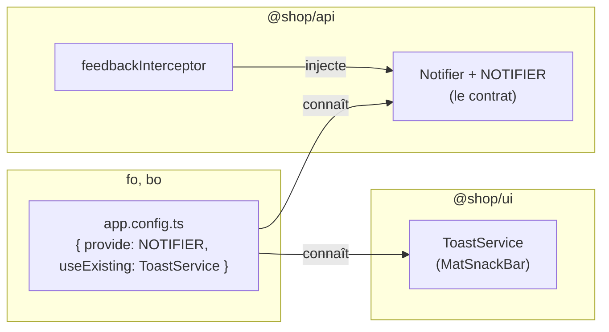

# 🔔 09 — Bonus : de vraies notifications

> **Scénario bonus, guidé, environ 25 minutes.** Depuis l'étape 02, l'intercepteur de
> `@shop/api` signale les erreurs HTTP dans la console, que l'utilisateur ne voit jamais. Vous le
> faites parler à l'écran, avec une snackbar Angular Material, **sans** que `api` dépende de
> `ui`. Trois endroits changent : `api` déclare un contrat, `ui` l'implémente, chaque application
> branche l'un sur l'autre. Les `// TODO` se limitent à l'intercepteur ; la solution est dans
> `solution/libs/api/` et `solution/libs/ui/src/lib/services/`.

## ✨ Objectifs

- **Inverser une dépendance** : la bibliothèque qui a besoin d'un service déclare un contrat (une
  interface et un jeton), une autre l'implémente, et l'application assemble.
- Injecter un service **facultatif** (`inject(…, { optional: true })`) et prévoir un repli.
- Afficher un message avec `MatSnackBar`.
- (Facultatif) Demander un message de succès requête par requête, avec un `HttpContextToken`.

## 📁 Point de départ

Vous partez du workspace de l'étape 08. Voici ce que cette étape ajoute ou modifie :

```
libs/api/src/
├── lib/models/notifier.ts                   le contrat : Notifier et le jeton NOTIFIER (section 2)
├── lib/interceptors/feedback.interceptor.ts injecte NOTIFIER, et retombe sur la console (section 3)
└── public-api.ts                            + l'export du contrat (section 2)
libs/ui/src/
├── lib/services/toast.service.ts            ToastService, la snackbar (section 4)
└── public-api.ts                            + l'export du service (section 4)
apps/fo/src/app/app.config.ts                le branchement (section 5)
apps/bo/src/app/app.config.ts                le même branchement (section 5)
libs/auth/src/lib/services/session.store.ts  un message de succès à la connexion (section 7, facultative)
```

---

## 🧭 1 — Le problème : qui dépend de qui ?

Afficher une snackbar demande `MatSnackBar`, un service d'affichage. La solution la plus directe
serait de l'injecter dans `feedbackInterceptor`. Mais l'intercepteur vit dans `@shop/api`, et la
règle de l'étape 01 est claire : `api` n'importe rien d'interne au workspace, et ne connaît aucune
interface graphique. Une bibliothèque de données qui ouvre des snackbars ne serait plus
réutilisable dans une application qui affiche ses messages autrement (un bandeau, un toast
maison, rien du tout dans un test).

On **inverse** donc la dépendance. `api` dit **de quoi** elle a besoin : « quelqu'un qui sait
afficher une erreur ». `ui` fournit **comment** : une snackbar. Et l'application, qui connaît les
deux, branche l'un sur l'autre. Le schéma suivant montre les trois rôles ; aucune flèche ne relie
`api` à `ui` :



C'est le même schéma qu'à l'étape 08 avec `REMOTE_LOADER` : une bibliothèque déclare un jeton,
l'application le remplit au démarrage. Une version précédente de ce cours faisait appeler la
snackbar directement par la bibliothèque `api` : c'est ce défaut de conception que cette étape
corrige.

---

## 📜 2 — Le contrat, dans `@shop/api`

Le contrat a deux parties. L'**interface** `Notifier` décrit les méthodes attendues : `error`,
obligatoire, et `success`, facultative (le `?`). Le **jeton** `NOTIFIER` est la clé sous laquelle
l'application fournira l'implémentation : une interface TypeScript disparaît à la compilation,
elle ne peut pas servir de clé à l'injecteur. Générez le fichier dans la famille `models/` :

```bash
npx ng generate interface models/notifier --project @shop/api
```

Remplacez le contenu de `libs/api/src/lib/models/notifier.ts` :

```ts
import { InjectionToken } from '@angular/core';

/**
 * Le contrat d'un notificateur : ce dont l'api a besoin pour prévenir l'utilisateur.
 * L'api ne sait pas COMMENT (snackbar, toast, bandeau) : c'est l'application qui fournit l'implémentation.
 */
export interface Notifier {
  error(message: string): void;
  success?(message: string): void;
}

/** Le jeton sous lequel l'application fournit son Notifier : { provide: NOTIFIER, useExisting: … }. */
export const NOTIFIER = new InjectionToken<Notifier>('NOTIFIER');
```

Exportez-le dans la façade de `api`. Dans `libs/api/src/public-api.ts`, ajoutez cette ligne sous
celle de `api.config` :

```ts
export * from './lib/models/notifier';
```

> 📖 [`InjectionToken`](https://angular.dev/api/core/InjectionToken)

---

## 🛡️ 3 — L'intercepteur injecte le contrat

L'intercepteur garde sa structure de l'étape 02 ; deux choses changent. Il injecte le
`Notifier`, en **facultatif** : une application qui n'en fournit pas (`marketing` lancée seule,
un test) fonctionne toujours, `inject` renvoie alors `null`. Et le message devient lisible par un
humain : « Le serveur ne répond pas » plutôt que `GET /api/products : erreur 502`.

Un détail de syntaxe d'abord : l'intercepteur était une fonction fléchée qui renvoyait directement
`next(req).pipe(…)`. Il lui faut maintenant une instruction avant le `return` (l'`inject`), donc
des accolades. Remplacez le contenu de `libs/api/src/lib/interceptors/feedback.interceptor.ts`, et
complétez les trois `TODO` :

🚧 **À compléter :**

```ts
import { HttpErrorResponse, HttpInterceptorFn } from '@angular/common/http';
import { inject } from '@angular/core';
import { catchError, throwError } from 'rxjs';
import { NOTIFIER, Notifier } from '../models/notifier';

/**
 * Le retour à l'utilisateur, centralisé : chaque appel HTTP qui échoue est signalé ici, et nulle part ailleurs.
 * Le COMMENT est fourni par l'application (NOTIFIER) ; sans lui, on retombe sur la console.
 */
export const feedbackInterceptor: HttpInterceptorFn = (req, next) => {
  // TODO 1 : injecter NOTIFIER en facultatif ({ optional: true }), dans une constante notifier

  return next(req).pipe(
    catchError((err: unknown) => {
      // 401 n'est pas une panne : « personne n'est connecté », c'est l'affaire de @shop/auth
      if (err instanceof HttpErrorResponse && err.status !== 401) {
        report(notifier, messageFor(err));
      }
      return throwError(() => err); // l'erreur continue son chemin jusqu'à l'appelant
    }),
  );
};

/** Un message pour un humain, à partir du statut HTTP. */
function messageFor(err: HttpErrorResponse): string {
  if (err.status === 403) {
    return "Action refusée : votre compte n'a pas les droits nécessaires.";
  }
  // TODO 2 : statut 0 (pas de réponse du tout) ou >= 500 => 'Le serveur ne répond pas. Réessayez dans un instant.'
  return `La requête a échoué (erreur ${err.status}).`;
}

/** Le seul endroit qui décide où va le message : le Notifier de l'application, sinon la console. */
function report(notifier: Notifier | null, message: string): void {
  // TODO 3 : si notifier existe, notifier.error(message) ; sinon console.error(`[api] ${message}`)
}
```

Voici les indices :

| TODO | Indice |
|---|---|
| 1 | `const notifier = inject(NOTIFIER, { optional: true });` : un intercepteur fonctionnel peut appeler `inject`, comme `authInterceptor` à l'étape 04 |
| 2 | un `if` sur le statut, sur le modèle du `403` juste au-dessus (la condition est écrite sous le tableau). Le statut `0` signifie qu'aucune réponse n'est arrivée (réseau coupé) ; derrière le proxy de développement, une API arrêtée répond `502 Bad Gateway` |
| 3 | un `if … else` ; c'est la fonction `report()` de l'étape 02, qui gagne un paramètre |

La condition du `TODO 2` s'écrit `err.status === 0 || err.status >= 500`.

La fonction `report()` était déjà le « seul endroit qui décide comment on signale » : c'est ce
choix de l'étape 02 qui rend le changement si local.

> 📖 [`inject` et ses options](https://angular.dev/api/core/inject) ·
> [Intercepteurs](https://angular.dev/guide/http/interceptors)

---

## 🍞 4 — `ToastService`, dans `@shop/ui`

L'implémentation est un service de `ui`, la bibliothèque des briques d'affichage. Générez-le dans
la famille `services/`, avec le suffixe `.service` (l'option `--type service`) :

```bash
npx ng generate service services/toast --type service --project @shop/ui --skip-tests
```

La CLI crée `libs/ui/src/lib/services/toast.service.ts`, avec une classe `ToastService` vide sous
`@Service()`, le décorateur d'Angular 22 vu à l'étape 02 : une seule instance, fournie à la racine
de l'application (en v20 : `@Injectable({ providedIn: 'root' })`). Le service injecte `MatSnackBar` et l'ouvre avec le message ; une erreur reste
affichée plus longtemps, avec un bouton « Fermer ». À l'intérieur de `ui`, Material s'importe
directement (étape 01). Remplacez son contenu :

```ts
import { Service, inject } from '@angular/core';
import { MatSnackBar } from '@angular/material/snack-bar';

/**
 * Les messages à l'écran, en snackbar Material. Ce service ne connaît pas l'api : il a seulement
 * la forme qu'elle attend (error, success), et c'est l'application qui le branche sur NOTIFIER.
 */
@Service()
export class ToastService {
  private readonly snackBar = inject(MatSnackBar);

  error(message: string): void {
    this.snackBar.open(message, 'Fermer', { duration: 6000 });
  }

  success(message: string): void {
    this.snackBar.open(message, undefined, { duration: 3000 });
  }
}
```

Exportez-le, à la fin de `libs/ui/src/public-api.ts` :

```ts
export * from './lib/services/toast.service';
```

> ℹ️ **Pas de `implements Notifier` ?** Écrire `implements Notifier` obligerait `ui` à importer
> `@shop/api`, ce que la règle interdit. TypeScript n'en a pas besoin : son typage est
> **structurel**, il compare les formes, et `ToastService` a bien `error(message: string)` et
> `success(message: string)`. La contrepartie : avec `useExisting` (section suivante), rien ne
> vérifie cette forme à la compilation. Pour qu'elle le soit, l'application peut écrire
> `{ provide: NOTIFIER, useFactory: (): Notifier => inject(ToastService) }` : le type de retour
> `Notifier` fait vérifier `ToastService` par le compilateur.

> 📖 [Angular Material : snackbar](https://material.angular.dev/components/snack-bar/overview)

---

## 🔌 5 — L'application assemble

L'application est le seul projet qui connaît à la fois `api` et `ui` : c'est elle qui dit
« pour `NOTIFIER`, utilise `ToastService` ». `useExisting` fournit sous le jeton l'instance
**existante** de `ToastService` (celle de `@Service()`), sans en créer une seconde. Dans
`apps/fo/src/app/app.config.ts` :

1. ajoutez `NOTIFIER` à l'import existant de `@shop/api`, à côté de `provideApi`, et importez
   `ToastService` depuis `@shop/ui` ;
2. ajoutez ce provider à la fin du tableau `providers`, après `provideAuth()` :

```ts
    // l'application assemble : le contrat de l'api (NOTIFIER) reçoit l'implémentation de ui (ToastService)
    { provide: NOTIFIER, useExisting: ToastService },
```

Faites exactement la même chose dans `apps/bo/src/app/app.config.ts`. Ne touchez pas à
`apps/marketing/src/app/app.config.ts` : `marketing` lancée seule ne fournit pas de `NOTIFIER`, et
c'est justement le cas du repli vers la console.

---

## 🚀 6 — Vérifier

Les builds et les tests d'abord, dans le terminal 4 :

```bash
npx ng build fo
npx ng build bo
npx ng test fo --watch=false
```

Les deux builds réussissent, et le test affiche toujours `Tests  4 passed (4)`. Arrêtez ensuite
le FO et le BO (`Ctrl-C` dans les terminaux 2 et 3), et relancez-les (`npm run fo`, `npm run bo`) :
ne vous contentez pas de leur recompilation automatique. `marketing`, elle, n'utilise pas la
snackbar : sa recompilation automatique suffit.

> ⚠️ **Piège : une nouvelle dépendance, serveur non relancé.**
> - *Symptôme :* sans relance, http://localhost:4200 reste blanc, et la console affiche
>   `ReferenceError: ngDevMode is not defined`, dans un fichier
>   `.angular/cache/…/vite/deps/@angular_material_snack-bar.js`.
> - *Cause :* `ToastService` est le premier code à importer `@angular/material/snack-bar`. La
>   liste des dépendances partagées par la fédération (étape 08) est calculée au **démarrage** du
>   serveur : la snackbar n'y est pas, et le serveur de développement la sert à part, hors de
>   l'*import map*, où elle ne trouve pas Angular.
> - *Correctif :* relancer le serveur. La snackbar rejoint alors l'*import map* :
>   `Object.keys(JSON.parse(document.querySelector('script[type^="importmap"]').textContent).imports).filter((k) => k.includes('snack'))`
>   renvoie `['@angular/material/snack-bar']`.

> 💡 **Tester :**
> 1. **Une vraie panne.** Arrêtez l'API (`Ctrl-C` dans le terminal 1), puis rechargez
>    http://localhost:4200/catalog. La page affiche « Le catalogue est indisponible. », et une
>    snackbar apparaît en bas : « Le serveur ne répond pas. Réessayez dans un instant. », avec
>    « Fermer ». L'onglet Réseau montre `GET /api/products` => `502 Bad Gateway`. Relancez l'API
>    (`npm run api`).
> 2. **Un refus du serveur.** Connectez-vous en `alice` sur le FO, allez sur `/catalog`, et
>    lancez dans la console l'écriture de l'étape 04 :
>    `ng.getComponent(document.querySelector('lib-session-button')).session.http.delete('/api/products/1').subscribe({ error: () => {} })`.
>    La snackbar affiche « Action refusée : votre compte n'a pas les droits nécessaires. » :
>    c'est le `403` de l'étape 06, enfin visible.
> 3. **Le repli.** Dans la console, plus aucune ligne `[api] …` n'apparaît pour ces erreurs : le
>    `Notifier` a pris le relais. Si vous avez fait le bonus de l'étape 08, `marketing` lancée
>    seule appelle l'API sans fournir de `NOTIFIER` : API arrêtée, rechargez
>    http://localhost:4202, et la console affiche
>    `[api] Le serveur ne répond pas. Réessayez dans un instant.` Relancez ensuite l'API.

---

## ✅ 7 — Facultatif : un message de succès, à la demande

Le contrat prévoit `success?`, mais l'intercepteur ne l'appelle jamais : un message pour **chaque**
requête réussie serait insupportable. C'est l'appelant qui doit le demander, requête par requête.
Angular a un outil pour attacher une information à une requête : le **contexte HTTP**. On déclare
une clé, un `HttpContextToken`, avec sa valeur par défaut (`null` : pas de message), et
l'intercepteur la lit avec `req.context.get(…)`.

Dans `feedback.interceptor.ts`, ajoutez `HttpContextToken` et `HttpResponse` à l'import de
`@angular/common/http`, et `tap` à celui de `rxjs`. Déclarez la clé, sous les imports :

```ts
/** Facultatif : un message de succès, demandé requête par requête (null = pas de message). */
export const SUCCESS_MESSAGE = new HttpContextToken<string | null>(() => null);
```

Dans l'intercepteur, ajoutez un `tap` **avant** le `catchError` : il voit passer les événements de
la requête, et la réponse finale est une `HttpResponse`.

```ts
  return next(req).pipe(
    tap((event) => {
      const success = req.context.get(SUCCESS_MESSAGE);
      if (success && event instanceof HttpResponse) {
        notifier?.success?.(success);
      }
    }),
    catchError((err: unknown) => {
```

Les deux `?.` correspondent aux deux absences possibles : pas de `Notifier` du tout, ou un
`Notifier` sans méthode `success`. Le fichier exporte déjà tout son contenu par la façade : la clé
est disponible sous `@shop/api`. Cette fois, inutile de relancer les serveurs : aucune nouvelle
dépendance n'apparaît (`HttpContext` vient de `@angular/common/http`, déjà partagé), la
recompilation automatique suffit.

Il reste à demander un message. La connexion est un bon candidat : dans
`libs/auth/src/lib/services/session.store.ts`, ajoutez `HttpContext` à l'import de
`@angular/common/http` et `SUCCESS_MESSAGE` à celui de `@shop/api` (la règle `auth => api` le
permet), puis passez un troisième argument au `post` de `login()` :

```ts
      this.http.post<User>(
        `${this.apiUrl}/auth/login`,
        { username, password },
        // un message de succès, demandé pour cette requête seulement (étape bonus 09)
        { context: new HttpContext().set(SUCCESS_MESSAGE, 'Vous êtes connecté.') },
      ),
```

> 💡 **Tester :** connectez-vous sur le BO (http://localhost:4201/login) en `admin` / `admin` :
> une snackbar « Vous êtes connecté. » s'affiche trois secondes au-dessus de la liste des
> produits. Un mauvais mot de passe, lui, ne donne aucune snackbar : c'est un `401`, que
> l'intercepteur laisse à la page de connexion.

> 📖 [Métadonnées de requête : `HttpContext`](https://angular.dev/guide/http/interceptors#request-and-response-metadata)

---

## 🎉 Challenge final

- [ ] `@shop/api` n'importe toujours rien du workspace, et `@shop/ui` n'importe pas `@shop/api`.
- [ ] Une API arrêtée donne une snackbar dans le FO et dans le BO.
- [ ] Une application sans `NOTIFIER` retombe sur la console.
- [ ] (Facultatif) La connexion affiche « Vous êtes connecté. ».

## 🧠 Récap

- **Inverser une dépendance** : la bibliothèque qui a besoin d'un service déclare le contrat
  (`Notifier`) et sa clé (`NOTIFIER`) ; une autre l'implémente (`ToastService`) ; l'application,
  qui connaît les deux, assemble (`{ provide: NOTIFIER, useExisting: ToastService }`).
- `inject(…, { optional: true })` rend la dépendance facultative : sans `Notifier`, la console.
- Le typage structurel de TypeScript permet à `ui` d'avoir la bonne forme sans importer `api`.
- Un `HttpContextToken` attache une information à **une** requête : l'appelant demande, et
  l'intercepteur, transversal, exécute.

---

Vous avez terminé le lab. Retour au [README](../README.md).
