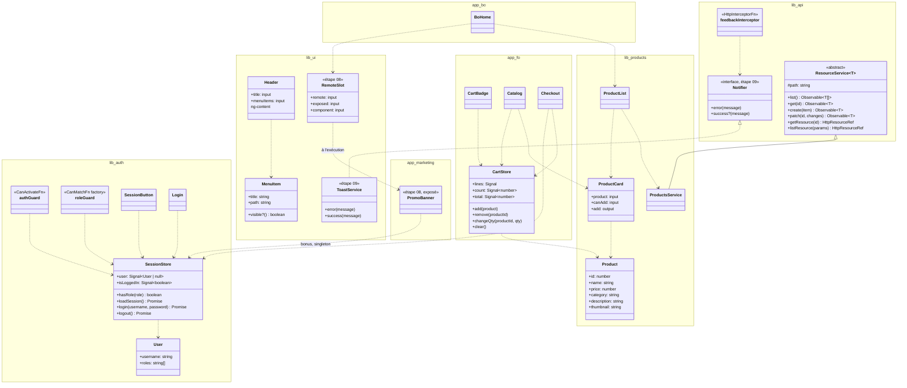

# 🛒 03 — MiniShop : un workspace, deux applications, quatre bibliothèques

> **Scénario à réaliser en autonomie, en un seul parcours pour tout le groupe.** Vous construisez
> une petite boutique en ligne, de la commande `ng new` jusqu'aux tests : une vitrine pour les
> clients (`fo`, le front-office), un back-office pour les administrateurs (`bo`), et quatre
> bibliothèques que les deux applications partagent. L'étape 08 ajoute une troisième application,
> `marketing`, dont la bannière promo est chargée par le FO et le BO en **micro-frontend**, et
> l'étape bonus 09 affiche enfin les erreurs HTTP à l'écran. Chaque étape vous guide ; là où un
> fichier est à écrire, les parties à compléter sont marquées `// TODO`. Le dossier `solution/`
> contient le projet terminé, à n'ouvrir qu'en cas de blocage.

> **Niveau : débutant à confirmé, un seul parcours.** Le lab est écrit pour qui a fait le tutoriel
> Housing et le jour 2 : composants, `input()` / `output()`, signals, routes, `HttpClient` et
> `httpResource`, Signal Forms. Il ne suppose **pas** que vous ayez déjà créé un workspace à
> plusieurs projets, une bibliothèque, un store, un intercepteur ou un guard : tout cela est
> expliqué au moment où vous en avez besoin. Si vous venez d'un projet Angular 20 avec Nx ou NgRx,
> vous irez plus vite sur les premières étapes : les encadrés « 🏢 En entreprise » et les liens de
> doc sont vos sorties, et le guidage diminue d'étape en étape (l'étape 06 se fait presque seule).

---

## ✨ Objectifs

- Créer un **workspace** Angular qui contient deux applications et quatre bibliothèques, et
  importer une bibliothèque par un alias `@shop/…`.
- Ranger le code **par concept**, puis **par famille** à l'intérieur (`models/`, `services/`,
  `components/`, `pages/`, `guards/`, `interceptors/`), et respecter des **règles de dépendance**
  entre bibliothèques.
- Écrire un **service qui sert de store** (le panier) avec des signals, et le persister.
- Gérer une **session par cookie httpOnly** : chargement au démarrage, connexion, déconnexion,
  intercepteur qui réagit à un 401.
- Protéger des routes avec des **guards** (`canActivate`, `canMatch`), et partager la même règle
  avec l'affichage du menu.
- **Tester** un composant, un composant qui charge des données, et des services, avec Vitest.
- Charger un composant d'une autre application **à l'exécution** (un micro-frontend, avec Native
  Federation), et partager la session en singleton.
- (Bonus) **Inverser une dépendance** : `api` déclare un contrat, `ui` l'implémente,
  l'application assemble.

---

## 🎬 Le scénario

La boutique vend un peu de tout : beauté, parfums, mobilier, épicerie (trente produits). Un client
parcourt le catalogue, remplit son panier sans
être connecté, puis se connecte pour passer commande. Un administrateur, lui, ouvre le
back-office pour consulter les produits. Les deux applications parlent à la même API, qui décide
seule de ce que chacun a le droit de faire.

Deux comptes de démonstration existent, **factices**, écrits en clair dans le serveur de test :
`alice` / `alice` (rôle `customer`, une cliente) et `admin` / `admin` (rôle `admin`). Ils ne
servent qu'à ce lab.

---

## 🏗️ Ce que vous construisez

### 📁 La vision finale

Voici l'arborescence du workspace à la fin de l'étape 09. C'est une **vision finale**, pas un
point de départ : l'étape 01 crée le contenant, chaque étape suivante ajoute ses fichiers, et le
tableau des étapes plus bas dit qui crée quoi. Les fichiers de configuration générés par la CLI
ou par Native Federation (`tsconfig.*.json`, `ng-package.json`, `README.md`, `bootstrap.ts`) ne
sont pas listés.

```
shop/
├── angular.json                             8 projets : fo, bo, marketing, @shop/api, @shop/auth, @shop/ui, @shop/products, @shop/util
├── package.json                             un seul pour tout le workspace ; scripts api, fo, bo, marketing
├── tsconfig.json                            les alias @shop/* vers les sources des bibliothèques
├── proxy.conf.json                          /api => http://localhost:3000, pour les deux applications
├── api/server.js, db.json                   l'API de démonstration (json-server 0.17.4 en module)
├── libs/
│   ├── api/src/lib/
│   │   ├── api.config.ts                        le jeton API_URL + provideApi({ url }) (branche aussi l'intercepteur de retour d'erreur)
│   │   ├── models/notifier.ts                   le contrat Notifier et son jeton NOTIFIER (étape 09)
│   │   ├── services/resource.service.ts         ResourceService<I, T>, abstraite (Observables + fabriques httpResource)
│   │   └── interceptors/feedback.interceptor.ts erreurs => le NOTIFIER de l'application, sinon console.error (étape 09)
│   ├── auth/src/lib/
│   │   ├── auth.config.ts                       provideAuth() : charge la session au démarrage
│   │   ├── models/user.ts
│   │   ├── services/session.store.ts            user, isLoggedIn, hasRole(), loadSession(), login(), logout()
│   │   ├── guards/auth.guard.ts, role.guard.ts  authGuard ; roleGuard(role), une fabrique de guard
│   │   ├── interceptors/auth.interceptor.ts     401 => page de connexion, avec returnUrl
│   │   ├── components/session-button/          anonyme => « Se connecter » (returnUrl) ; connecté => nom + « Se déconnecter »
│   │   └── pages/login/                         la page et son formulaire
│   ├── ui/src/lib/
│   │   ├── material.ts                          le barrel des modules Material utilisés
│   │   ├── models/menu-item.ts                  { title, path, visible?: () => boolean }
│   │   ├── models/remote-loader.ts              le contrat « charger un module distant » et son jeton REMOTE_LOADER (étape 08)
│   │   ├── components/layout/header/            inputs title + menuItems, et un emplacement <ng-content> (ui ne dépend PAS de auth)
│   │   ├── components/remote-slot/              affiche un composant chargé d'un remote, ou un repli (étape 08)
│   │   └── services/toast.service.ts            ToastService, la snackbar Material (étape 09)
│   ├── products/src/lib/
│   │   ├── models/product.ts
│   │   ├── services/products.service.ts         @Service() extends ResourceService<number, Product> (lecture)
│   │   └── components/product-card/, product-list/
│   └── util/src/lib/
│       └── types/controls-of.ts                 ControlsOf<T> : typer un formulaire réactif à partir d'un modèle (pour aller plus loin)
└── apps/
    ├── fo/                federation.config.mjs, public/federation.manifest.json (hôte dynamique, étape 08)
    │   └── src/app/       app.ts, app.config.ts, app.routes.ts
    │       ├── features/catalog/  catalog.routes.ts, pages/catalog/, pages/product-detail/
    │       ├── features/cart/     cart.routes.ts, services/cart.store.ts, pages/cart/, pages/checkout/ (authGuard), components/cart-badge/
    │       └── pages/home/ (la bannière de marketing), not-found/
    ├── bo/                federation.config.mjs, public/federation.manifest.json (hôte dynamique, étape 08)
    │   └── src/app/       app.ts, app.config.ts, app.routes.ts (home sous roleGuard('admin') en canMatch, page de connexion de @shop/auth)
    │       └── pages/home/ (la bannière, puis product-list de @shop/products en lecture seule), not-found/
    └── marketing/         federation.config.mjs : le remote, il expose ./PromoBanner (étape 08)
        └── src/app/       app.ts, app.config.ts, components/promo-banner/
```

Le tableau suivant reprend chaque projet, ce qu'il contient, et pourquoi le découpage est
celui-là :

| Projet | Ce qu'il contient | Pourquoi à cet endroit |
|---|---|---|
| `@shop/api` | l'adresse de l'API (`API_URL`), `provideApi()`, la classe générique `ResourceService<I, T>` du jour 2, et un intercepteur qui signale les erreurs HTTP (dans la console pour l'instant ; un vrai message à l'écran viendra avec l'étape bonus 09) | la mécanique HTTP, sans aucun métier : toutes les bibliothèques qui parlent à l'API en dépendent |
| `@shop/auth` | la session (`SessionStore`), les guards, l'intercepteur du 401, le bouton de session, la page de connexion, `provideAuth()` | le FO **et** le BO ont besoin de se connecter : le code vit une fois, dans une bibliothèque |
| `@shop/ui` | le barrel Material, l'en-tête (`Header`) et le contrat de ses liens (`MenuItem`) | des briques d'affichage, sans données ni session : l'en-tête reçoit tout par ses `input()` et son emplacement `<ng-content>` |
| `@shop/products` | le modèle `Product`, `ProductsService` (lecture), la carte et la liste de produits | le catalogue du FO et la page d'accueil du BO affichent les mêmes produits |
| `fo` | le catalogue, le **panier** et la commande | le panier reste une feature du FO : le BO n'a pas de panier. On extrait une bibliothèque quand **deux** applications en ont besoin, pas avant |
| `bo` | une page d'accueil réservée au rôle `admin`, qui réutilise la liste de `@shop/products` | une bibliothèque, deux applications |
| `marketing` | la bannière promo, `PromoBanner`, exposée par Native Federation (étape 08) | une équipe qui livre seule : la bannière est chargée par le FO et le BO **à l'exécution**, sans les recompiler |
| `@shop/util` | des types et fonctions sans état, comme `ControlsOf<T>` pour les formulaires réactifs (voir « Pour aller plus loin ») | du code transversal sans dépendance interne, utilisable partout ; aucune étape ne l'impose |

Chaque bibliothèque déclare **ses propres types** (`Product` dans `products`, `User` dans `auth`,
`MenuItem` dans `ui`) : il n'y a pas de bibliothèque `models` commune, ni de `shared` ou de
`common`, qui finissent en fourre-tout que tout le monde importe. Quand un vrai besoin transversal
apparaît, on crée une bibliothèque `util` à ce moment-là : c'est le cas de `ControlsOf<T>`, un type
générique pour les formulaires réactifs, présenté à la fin de ce README. Le nom `util` annonce la
règle : des types et des fonctions sans état, qui ne dépendent d'aucune autre bibliothèque.

Le rangement suit une convention en deux temps : **d'abord par concept** (une bibliothèque, ou un
dossier `features/<feature>/` dans une application), **puis par famille** à l'intérieur
(`models/`, `services/`, `components/`, `pages/`, `guards/`, `interceptors/`). Le
[guide de style Angular](https://angular.dev/style-guide#organize-your-project-by-feature-areas)
recommande de ranger par concept et d'éviter les dossiers par type de fichier ; ce cours combine
les deux, pour qu'on retrouve un fichier en deux questions : « de quoi parle-t-il ? », puis
« qu'est-ce que c'est ? ».

### 🧭 Les règles de dépendance

Une bibliothèque ne doit pas importer n'importe quelle autre. Ces règles évitent les cycles et
gardent chaque brique réutilisable ; la CLI Angular ne les vérifie pas (Nx sait le faire, voir la
[synthèse workspace](https://bngams.github.io/2610-ng/03-intro-workspace/)), c'est donc à vous de
les respecter en écrivant vos `import` :

| Projet | Peut importer | Ne doit jamais importer |
|---|---|---|
| `@shop/ui` | Angular et Angular Material seulement | `api`, `auth`, `products` : l'en-tête ne connaît pas la session, l'application lui **projette** le bouton de session |
| `@shop/api` | rien d'interne au workspace | toute autre bibliothèque |
| `@shop/auth` | `@shop/api` (et Angular Material, directement) | `ui`, `products`, les applications |
| `@shop/products` | `@shop/api`, `@shop/ui` | `auth`, les applications |
| `@shop/util` | Angular seulement (`@angular/forms` pour `ControlsOf`) | toute autre bibliothèque, les applications |
| `fo`, `bo`, `marketing` | toutes les bibliothèques | une autre application (le FO charge la bannière de `marketing` à l'exécution, sans l'importer) |

La dernière règle se lit aussi dans l'autre sens : **aucune bibliothèque n'importe une
application**. C'est pour cela que la carte produit de `@shop/products` ne connaît pas le panier du
FO : elle émet un événement (un `output()`), et c'est le FO qui le branche sur son panier.

### 🗺️ Le diagramme de classes

Le diagramme suivant montre les classes principales, rangées par projet, et les liens qui
comptent : l'héritage (`<|--`) et les dépendances (`..>`, « utilise »). Il sert de carte : revenez-y
quand une étape vous fait créer une classe, pour voir où elle se place. Les classes des étapes 08
et 09 y figurent aussi : la bannière de `marketing`, l'emplacement qui la charge, le contrat
`Notifier` et sa snackbar.



Dans le code, `ResourceService` a deux paramètres de type, `<I, T>` (l'identifiant et le modèle) ;
le diagramme n'en garde qu'un pour rester lisible. `BoHome` est la classe `Home` du BO, renommée
ici pour la distinguer de celle du FO (qui utilise aussi `RemoteSlot`). `ToastService` réalise
`Notifier` sans l'importer : `ui` ne dépend pas d'`api`, et c'est l'application qui branche l'un
sur l'autre (étape 09).

---

## 📦 Le dossier du lab

Ce dossier, `03-minishop/`, contient le guide et ce qu'il vous donne ; votre projet, lui, sera
créé à côté. Voici son contenu :

```
03-minishop/
├── README.md                    ce fichier
├── ETAPES/                      les étapes 01 à 09, une par fichier
├── assets/
│   ├── 02-catalogue/            le code fourni à l'étape 02 : l'API, le proxy, les bibliothèques api et products,
│   │                            la feature catalogue du FO (même arborescence que votre workspace)
│   └── 07-tests/                les squelettes de tests de l'étape 07, avec des it.todo
└── solution/                    le workspace terminé (sans node_modules : npm install avant de le lancer)
```

Les commandes `cp` du lab supposent que votre workspace `shop/` est **à côté** du dossier
`03-minishop/`, dans le dossier du cours : depuis `shop/`, les fichiers fournis sont donc dans
`../03-minishop/assets/`.

---

## 🚀 Prérequis

Angular 22 exige **Node 24.15+** (ou **22.22.3+**, voir la
[matrice des versions](https://angular.dev/reference/versions)) : en dessous, la CLI s'arrête sur
« Please update your Node.js version ». Le lab a été validé avec Node 24.18.0, npm 11.16.0 et
Angular CLI 22.2.2 ; les micro-frontends de l'étape 08 avec `@angular-architects/native-federation`
22.2.2.

Vous aurez besoin de **quatre terminaux**, puis d'un cinquième à l'étape 08, tous ouverts dans
`shop/` une fois le workspace créé. Leur numéro reste le même dans tout le lab :

| Terminal | Commande | Rôle |
|---|---|---|
| 1 | `npm run api` | l'API, sur le port 3000 (à partir de l'étape 02) |
| 2 | `npm run fo` | la boutique, sur http://localhost:4200 |
| 3 | `npm run bo` | le back-office, sur http://localhost:4201 (lancé à l'étape 01 pour vérifier, puis de nouveau à partir de l'étape 06) |
| 4 | `npx ng …`, `cp …`, `curl …` | le terminal des commandes : générations, copies, builds, tests |
| 5 | `npm run marketing` | le remote de la bannière promo, sur http://localhost:4202 (à partir de l'étape 08) |

Gardez la console du navigateur ouverte (F12) pendant tout le lab : les erreurs HTTP y sont
signalées, et plusieurs vérifications s'y font.

---

## 🗂️ Les étapes

Les étapes se font dans l'ordre : chacune part de l'état laissé par la précédente. Le guidage
diminue au fil du lab, de « chaque commande est donnée » (étape 01) à « voici le besoin et les
liens de doc » (étape 06). Le tableau suivant résume chaque étape et sa durée indicative :

| Étape | Ce que vous faites | Durée |
|---|---|---|
| [01 — Le workspace](ETAPES/01-WORKSPACE.md) | `ng new` sans application, `fo` et `bo`, quatre bibliothèques, les alias `@shop/*`, Angular Material, un en-tête partagé, les deux applications lancées | 40 min |
| [02 — L'API et le catalogue](ETAPES/02-API-CATALOGUE.md) | code fourni et commenté : l'API, le proxy, `@shop/api`, `@shop/products`, les pages du catalogue (l'étape peut se faire en démo formateur) | 15 à 30 min |
| [03 — Le panier](ETAPES/03-PANIER.md) | un service qui sert de store, persisté dans `localStorage`, le badge dans l'en-tête, la page panier et la commande | 40 min |
| [04 — La session](ETAPES/04-SESSION.md) | la session par cookie httpOnly : `SessionStore`, page de connexion, bouton de session, intercepteur du 401, chargement au démarrage | 60 min |
| [05 — Les guards côté FO](ETAPES/05-GUARDS.md) | `authGuard` sur la commande, et la même règle pour afficher un lien du menu | 20 min |
| [06 — Le BO minimal](ETAPES/06-BO.md) | l'accueil du BO sous `roleGuard('admin')` en `canMatch`, la page de connexion et la liste de produits réutilisées, le refus du serveur au `curl` | 20 min |
| [07 — Les tests](ETAPES/07-TESTS.md) | Vitest : la carte produit, la liste de produits (HTTP simulé), le store du panier et `ProductsService` ; guard et intercepteur en bonus | 45 min |
| [08 — Une bannière promo en micro-frontend](ETAPES/08-MICRO-FRONTEND.md) | une application `marketing` en remote Native Federation, le FO et le BO en hôtes dynamiques, la bannière chargée dans les deux accueils avec un repli ; une promo changée en relançant `marketing` seule ; en bonus, la session partagée en singleton | 50 min |
| [09 — Bonus : de vraies notifications](ETAPES/09-NOTIFICATIONS.md) | les erreurs HTTP en snackbar sans dépendance `api => ui` : un contrat `Notifier` dans `api`, `ToastService` dans `ui`, le branchement dans chaque application | 25 min |

> 📖 Les synthèses du jour 3 développent les notions que ce lab met en pratique :
> [authentification et autorisation](https://bngams.github.io/2610-ng/03-intro-auth/) ·
> [un service comme store](https://bngams.github.io/2610-ng/03-intro-store/) ·
> [workspace, bibliothèques et micro-frontends](https://bngams.github.io/2610-ng/03-intro-workspace/)

## 🧰 Pour aller plus loin : typer un formulaire avec `@shop/util`

Le lab type ses formulaires réactifs par inférence : `NonNullableFormBuilder` déduit le type de
chaque contrôle de sa valeur de départ. Dès qu'un formulaire suit un modèle existant, on préfère
partir du modèle : on écrit `FormGroup<ControlsOf<Dossier>>`, et le compilateur vérifie que le
formulaire a exactement la forme du modèle. Aucune étape ne s'en sert ; la solution contient le type,
testé, et **libre à vous de l'utiliser** dans vos formulaires, ici ou sur votre projet.

Le type vit dans une bibliothèque `util`, créée comme les autres à l'étape 01, depuis le terminal 4 :

```bash
npx ng generate library @shop/util --project-root libs/util
```

Comme pour les quatre autres bibliothèques, faites pointer l'alias vers les sources dans
`tsconfig.json`, à la place du chemin `./dist/shop/util` écrit par la CLI :

```json
      "@shop/util": ["./libs/util/src/public-api.ts"]
```

Supprimez ensuite les deux fichiers d'exemple de la CLI, `libs/util/src/lib/util.ts` et
`util.spec.ts`, puis créez le type dans `libs/util/src/lib/types/controls-of.ts`. Son contenu est
dans la solution :
[solution/libs/util/src/lib/types/controls-of.ts](solution/libs/util/src/lib/types/controls-of.ts).
Le tableau suivant montre ce qu'il produit pour chaque sorte de champ :

| Champ du modèle | Contrôle produit |
|---|---|
| `name: string`, `income: number` | `FormControl<string>`, `FormControl<number>` |
| `moveIn: Date` | `FormControl<Date>` |
| `address: { city: string }` | `FormGroup<{ city: FormControl<string> }>` |
| `tags: string[]` | `FormArray<FormControl<string>>` |
| `guarantors: Guarantor[]` | `FormArray<FormGroup<ControlsOf<Guarantor>>>` |

La ligne `Date` mérite un mot : une `Date` est un objet, et une version naïve du type (« tout objet
devient un `FormGroup` ») en ferait un groupe. Nous l'avons vérifié : un champ `Date` donne alors
l'erreur `TS2322` dès qu'on y met un `fb.control(new Date())`. Le type de la solution teste donc
`Date` avant les objets. Autre limite à connaître : un objet optionnel ou nullable
(`address?: Address`) devient un simple `FormControl` ; gardez obligatoires les objets que vous
voulez éditer champ par champ.

Exportez le type dans la façade `libs/util/src/public-api.ts`, puis utilisez-le dans un formulaire :

```ts
const form: FormGroup<ControlsOf<Dossier>> = this.fb.group({
  name: this.fb.control(''),
  moveIn: this.fb.control(new Date()),
  address: this.fb.group({ city: this.fb.control('') }),
  tags: this.fb.array<string>([]),
  guarantors: this.fb.array([this.fb.group({ name: this.fb.control(''), income: this.fb.control(0) })]),
});
```

> 💡 **Tester :** la solution contient deux tests de typage dans
> [controls-of.spec.ts](solution/libs/util/src/lib/types/controls-of.spec.ts), dont un
> `@ts-expect-error` qui vérifie qu'un groupe est refusé là où le modèle attend une `Date`.
> `npx ng test @shop/util --watch=false` répond `Tests  2 passed (2)`.

➡️ Commencez par [01 — Le workspace](ETAPES/01-WORKSPACE.md).
